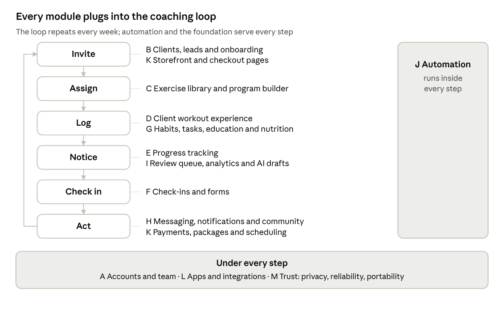
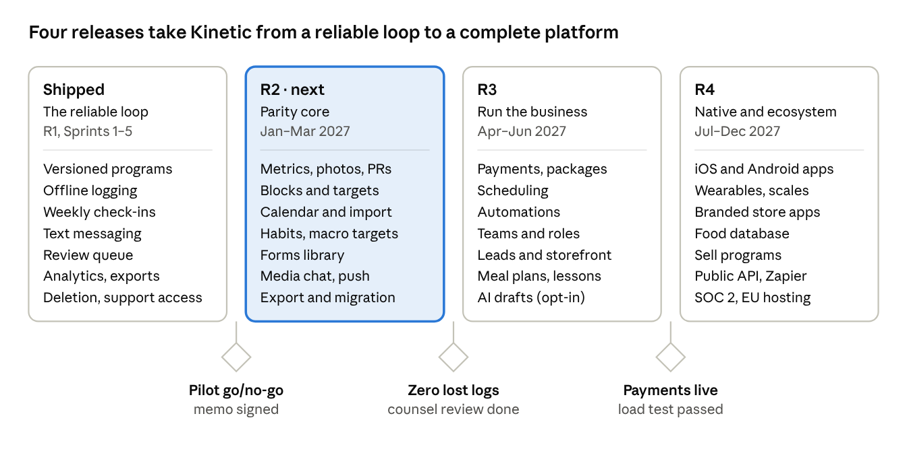

# Kinetic: Complete Coaching Platform PRD

Oct 31, 2026 · Repo copy of the live doc: https://claude.ai/artifact/1u1qfLgb9XJCQVko1PTttZ (the live doc wins if they differ)

## Executive summary

Kinetic becomes a complete online-coaching platform. It will match the 200 features coaches now expect from Trainerize, Everfit, Spur.fit, TrueCoach and Kahunas, and it will win on what users say those products get wrong: crashes and lost logs, add-on pricing, billing traps, lock-in, and coaching that feels generic.

Today Kinetic has a reliable core loop (Sprints 1–5): versioned programs, offline workout logging, weekly check-ins, messaging, a review queue, analytics, and export and deletion. This PRD defines everything else, in 13 modules, and phases it into three releases after R1.

**Six headline bets**, each a direct answer to a recurring complaint:

1. **Never lose a log.** Logging works offline and shows an honest sync state. Integrations show when they last synced. Competitors' reviews repeatedly cite crashes, lost data and sync that fails without telling anyone.
2. **One price, everything included.** No paid add-ons for automation, payments, video or nutrition. Everfit and Trainerize users call this "nickel and diming."
3. **Leave or arrive in an afternoon.** Full structured export, plus import from spreadsheets and from other platforms. Today coaches pay freelancers to rebuild programs by hand.
4. **Coaching that never feels generic.** A client context card, saved replies and video feedback are built into every review screen. Clients' top complaint about online coaches is "generic" and "cookie-cutter" plans.
5. **AI that assists, never replaces.** AI produces coach-reviewed drafts only, and is off by default. Athletes rate AI-only programs worse than coach-written ones.
6. **Fair billing.** One-click cancel for coaches and clients, and clients never lose access to their own history because a coach's subscription lapsed.

Every feature below carries an ID (module letter + number), a phase and its origin. **Parity** means competitors have it. **Pain point** means it answers a complaint in section 2. **Differentiator** means nobody does it well.

**Phases used throughout:**

| Phase   | Window (proposed) | Theme                                                                                |
| ------- | ----------------- | ------------------------------------------------------------------------------------ |
| Shipped | R1, Sprints 1–5   | The reliable coaching loop                                                           |
| R2      | Jan–Mar 2027      | Parity core: progress, richer programs, reminders, rich messaging, import and export |
| R3      | Apr–Jun 2027      | Run the business: payments, scheduling, automation, team, nutrition plans, AI drafts |
| R4      | Jul–Dec 2027      | Native apps, wearables, community at scale, content sales, public API                |

## Research basis

We found sixteen recurring pain points, and every one maps to features below. Reliability, add-on pricing and lock-in matter most because they make coaches switch platforms.

**How we got here.** Reddit itself could not be read: the search tool is blocked from reddit.com, and this environment blocks direct page fetches. The evidence below therefore comes from public reviews and feature-request boards where the same people post: Capterra, Trustpilot, G2, the App Store and Google Play, the Trainerize ideas forum, and articles that quote Reddit threads. Before R2 planning, someone should read r/personaltraining and r/OnlineCoaching directly and add anything new. Competitor parity comes from the earlier teardown in the repo (`docs/competitive/`).

| #   | Pain point                                                                                                                                                          | Who says it, and where                                                                                                                                                                                                                                                                                                                                               | Our answer              |
| --- | ------------------------------------------------------------------------------------------------------------------------------------------------------------------- | -------------------------------------------------------------------------------------------------------------------------------------------------------------------------------------------------------------------------------------------------------------------------------------------------------------------------------------------------------------------- | ----------------------- |
| P1  | Crashes, glitches and lost workout data                                                                                                                             | Trainerize reviewers on [Capterra](https://www.capterra.com/p/140262/Trainerize/); Everfit client app "crashes almost every time" on the [App Store](https://apps.apple.com/us/app/everfit-for-coach/id1485827117?see-all=reviews&platform=iphone); Kahunas slowdowns on [Trustpilot](https://www.trustpilot.com/review/kahunas.io)                                  | D3, D20, M8, M9         |
| P2  | Integrations fail quietly: MyFitnessPal, Apple Health, Apple Watch                                                                                                  | Trainerize coaches: MFP sync "constantly a pain"; edited meals don't resync ([ideas forum](https://ideas.trainerize.com/forums/940789-client-gym-members-abc-trainerize/suggestions/43656879-sync-updates-from-myfitnesspal), [JustUseApp](https://justuseapp.com/en/app/516851502/fitness-app-by-trainerize/reviews))                                               | L10, G11                |
| P3  | Add-on pricing: automation, payments, video and nutrition cost extra                                                                                                | Everfit: "charging an extra 50 dollars for automation" ([Trustpilot](https://nz.trustpilot.com/review/everfit.io)), "nickel and dime" ([Google Play](https://play.google.com/store/apps/details?id=com.everfit.coach&hl=en_US)); Trainerize add-ons from $10 to $45 ([Coachway](https://coachway.io/articles/trainerize-pricing/))                                   | M10, section 19         |
| P4  | Billing traps and hard cancellation                                                                                                                                 | Everfit: "worst billing in the industry," billed again months after cancelling ([Capterra](https://www.capterra.com/p/202837/Everfit/reviews/)); Trainerize: "no way to cancel" ([Trustpilot](https://dk.trustpilot.com/review/trainerize.com))                                                                                                                      | K8, M10                 |
| P5  | Locked out after a lapse or a missed app update                                                                                                                     | Trainerize logs users out when membership ends ([Capterra](https://www.capterra.com/p/140262/Trainerize/)); Everfit soft-locks clients who don't update ([Google Play](https://play.google.com/store/apps/details?id=com.everfit.coach&hl=en_US))                                                                                                                    | M11, M12                |
| P6  | Missing platforms and modules: no Android client app, no nutrition, slow feature pace                                                                               | TrueCoach reviews ([PT Pioneer](https://www.ptpioneer.com/personal-training/tools/truecoach-review/), [ProMealPlan](https://www.promealplan.com/en/blog/truecoach-review-2026))                                                                                                                                                                                      | L1, L2, Module G        |
| P7  | Builder limits: no weight prescription, 21-day cap, no video per circuit exercise, clumsy copy and move, recurring events edited one by one                         | Kahunas on [Capterra](https://www.capterra.com/p/10028886/Kahunas/); TrueCoach reviews; Trainerize ideas forum (114 votes on recurring events)                                                                                                                                                                                                                       | C7, C8, C10, C11, C16   |
| P8  | The coach app is hard to use on a phone                                                                                                                             | TrueCoach reviews ([ProMealPlan](https://www.promealplan.com/en/blog/truecoach-review-2026))                                                                                                                                                                                                                                                                         | A7                      |
| P9  | Spreadsheet patchwork; check-in data re-typed by hand; strain at 15–20 clients                                                                                      | Coaching blogs that quote coaches ([Assistant Coach](https://assistantcoach.fit/blog/google-sheets-to-fitness-coaching-software/), [Coaching Portal](https://coachingportal.io/blog/software-to-replace-coaching-spreadsheets)); a Reddit story of 40 clients in one "giant Google Sheet" ([Substack](https://mihais7.substack.com/p/30-personal-trainer-dashboard)) | C14, F8, B17            |
| P10 | Clients feel coaching is generic, copy-pasted, or that the coach forgot them                                                                                        | Client reviews of coaching businesses on Trustpilot ([Coachway summary](https://coachway.io/articles/what-clients-say-about-coaching-apps/))                                                                                                                                                                                                                         | B7, F7, H16             |
| P11 | Lock-in: programs can't be exported; freelancers rebuild them by hand                                                                                               | Fiverr and Upwork migration gigs ([example](https://www.fiverr.com/david_hub13/setup-transfer-and-upload-workout-programs-everfit-trainerize-hubfit-truecoach)); [Coachway: switching from Everfit](https://coachway.io/articles/how-to-switch-from-everfit/)                                                                                                        | M3, M4, B17             |
| P12 | Slow support; bugs open for months                                                                                                                                  | Kahunas and Everfit reviews ([Capterra](https://www.capterra.com/p/10028886/Kahunas/), [Trustpilot](https://au.trustpilot.com/review/everfit.io))                                                                                                                                                                                                                    | M13                     |
| P13 | Most-voted unmet requests: daily lessons (about 1,690 votes), custom macro splits, assessment photos, in-app e-signed contracts, custom forms, disengagement alerts | [Trainerize ideas forum](https://ideas.trainerize.com/)                                                                                                                                                                                                                                                                                                              | G4, G6, E5, B14, F2, I4 |
| P14 | Distrust of AI-only programs: in one study only 27.8% of athletes said AI-written plans worked well, and 77% of coaches say AI can't replace them                   | [Sports Performance Bulletin](https://www.sportsperformancebulletin.com/training/training-structure--planning/training-program-design-man-vs-machine); [FitBudd AI report](https://www.fitbudd.com/fitness-industry-trends/ai-fitness-coaching-report)                                                                                                               | I10–I14 (drafts only)   |
| P15 | Weak scheduling and calendars                                                                                                                                       | Everfit on [G2](https://www.g2.com/compare/coachrx-vs-everfit)                                                                                                                                                                                                                                                                                                       | K10, C16                |
| P16 | Payments unavailable in some regions                                                                                                                                | TrueCoach reviews; Spur.fit offers Razorpay alongside Stripe                                                                                                                                                                                                                                                                                                         | K1, K2                  |

## Product principles and positioning

**Positioning:** "The coaching platform that never drops the ball: not your client's log, not your client's check-in, not your bill." Competitors sell feature volume. Kinetic sells dependability plus every feature, at one price.

Eight principles decide trade-offs:

1. **The loop comes first.** Invite, assign, log, notice what needs attention, check in, act. A feature that slows any step of that loop doesn't ship.
2. **Honest state.** The UI never claims something synced, sent or paid before the server confirms it. This extends the "Saved on device / Syncing / Synced" rule to media, payments and integrations.
3. **History is immutable, corrections are audited.** Programs are versioned, logs keep their revisions, and messages can't be edited. New modules (metrics, nutrition, payments) follow the same rule.
4. **The coach is the author.** Automation and AI prepare drafts and queues. A human coach approves anything that changes a client's plan or speaks in the coach's voice.
5. **Everything included.** A feature is never held back behind an add-on. Plans differ only in client count and team seats.
6. **Your data is yours.** Everything a coach or client creates can be exported in a format another tool can import.
7. **Private by default.** Health-adjacent data (photos, metrics, check-ins, readiness) stays out of analytics, emails and push payloads. It is shared only with the client's coaches, with explicit consent.
8. **Accessible and mobile-first.** Every screen works at 375 px with one hand, keyboard and screen reader, to WCAG 2.2 AA.

These extend the existing rules in `docs/decisions.md`. Where a feature below conflicts with a locked decision, section 22 names the decision that needs changing.

## Personas, surfaces and the module map

The platform serves six personas through four surfaces. The 13 modules below are organized around what each persona does.

| Persona                           | Size                         | Core jobs                                                                              | Modules they live in |
| --------------------------------- | ---------------------------- | -------------------------------------------------------------------------------------- | -------------------- |
| Solo online coach                 | 5–50 clients                 | Program, review check-ins, message, get paid, stay organized from a phone              | B, C, F, H, I, K     |
| Hybrid coach (in person + online) | 10–40 clients                | Everything above, plus session booking, session packs and logging on a client's behalf | C, D, K              |
| Nutrition or habit coach          | 10–80 clients                | Macro targets, meal plans, habits, education, check-ins                                | F, G, H              |
| Studio or team owner              | 2–15 coaches, 50–500 clients | Assign clients to coaches, oversee quality, revenue and branding                       | A, I, K, L           |
| Client                            | 1 coach                      | See today's plan, log it in seconds, show progress, feel seen                          | D, E, F, G, H        |
| Lead                              | Not yet a client             | Learn about the coach, apply, pay                                                      | B, K                 |

**Surfaces**

- **Coach web app** (`/app`): desktop-first, fully usable at 375 px (A9).
- **Client portal** (`/portal`): installable PWA in R2 (L1); native iOS and Android apps in R4 (L2).
- **Public pages** (`/join/<coach>`): lead forms, storefront and checkout, with no login.
- **Platform admin** (`/admin`): support access, pilot codes, deletion verification. Already shipped.

Each module exists to make one step of the weekly loop faster or more reliable. A feature that serves no step doesn't belong in the platform.

## Module A: Accounts, workspace and team

A coach signs up, sets up a branded workspace, and later adds coaches without re-platforming. Today R1 has sign-up, workspaces and owner and coach roles. Self-serve trials, a usable coach experience on a phone, and real team management are missing.

| ID  | Feature                      | What it does                                                                                                 | Phase   | Origin         |
| --- | ---------------------------- | ------------------------------------------------------------------------------------------------------------ | ------- | -------------- |
| A1  | Email and Google sign-up     | Verified email or Google OAuth; 12-character minimum password with a breached-password check                 | Shipped | Parity         |
| A2  | Workspace creation           | Business name, time zone, units, check-in grace period                                                       | Shipped | Parity         |
| A3  | Dual-role account switcher   | One login can be a coach in one workspace and a client in another; strict separation                         | Shipped | Differentiator |
| A4  | Self-serve trial             | 14 days, up to 3 clients, no card; replaces pilot codes at general availability                              | R2      | Parity         |
| A5  | Setup checklist              | Guided first steps: brand, first program from a template, invite yourself as a test client, log a workout    | R2      | Parity         |
| A6  | Workspace branding           | Logo, accent colour (must pass AA contrast) and display name across the portal, emails and PDFs              | R2      | Parity         |
| A7  | Coach on mobile              | Every coach screen usable one-handed at 375 px: review queue, check-in review, messages, quick program edits | R2      | Pain point P8  |
| A8  | Two-factor authentication    | TOTP and recovery codes; required for owners when the workspace has more than one coach                      | R2      | Parity         |
| A9  | Sessions and devices         | See and sign out other devices; sign out everywhere                                                          | R2      | Parity         |
| A10 | Team roles                   | Owner, Admin, Coach, Assistant (can message and review, can't edit programs or billing)                      | R3      | Parity         |
| A11 | Primary coach and transfer   | Each client has a primary coach; transfer keeps all history and threads; audited                             | R3      | Parity         |
| A12 | Visibility scopes            | Coaches see "My clients" by default; owners and admins see all; optional cross-coach cover                   | R3      | Parity         |
| A13 | Coach cover and holiday mode | Hand a coach's queue to another coach for a date range; clients see who is covering                          | R3      | Differentiator |
| A14 | Owner audit log              | Content-free list of who did what and when (assignments, transfers, exports, support access)                 | R3      | Differentiator |
| A15 | Locations                    | Group coaches and clients by location for studios with several sites                                         | R4      | Parity         |
| A16 | Single sign-on               | Google Workspace and Microsoft SAML for larger studios                                                       | R4      | Parity         |

**Key rules**

- An Assistant can never see billing or delete anything. An Admin can do everything except close the workspace or change the owner.
- A transfer never changes who logged or wrote anything in history. Messages keep their original author.
- Coach on mobile (A7) is acceptance-tested on the six most-used coach tasks at 375 px. It is not a separate app.

**Screens:** `/signup`, `/onboarding` (A5), `/settings` with Branding, Team, Security and Devices sections, and `/settings/audit` (A14).

## Module B: Clients, leads and onboarding

Module B takes a stranger to a lead, a client and then a known person, and the coach remembers the details. The client context card (B7) is our answer to "my coach forgot what I told them" (P10).

| ID  | Feature                    | What it does                                                                                                                                                                                  | Phase   | Origin              |
| --- | -------------------------- | --------------------------------------------------------------------------------------------------------------------------------------------------------------------------------------------- | ------- | ------------------- |
| B1  | Client list                | Search, status filter, next session, unread count                                                                                                                                             | Shipped | Parity              |
| B2  | Email invites              | Single-use, expire after 7 days; resend revokes the old link                                                                                                                                  | Shipped | Parity              |
| B3  | Invite by link or QR code  | A reusable workspace link or QR code for in-person sign-ups, capped and revocable                                                                                                             | R2      | Parity              |
| B4  | Tags and segments          | Coloured tags; saved filters such as "Online, fat loss, week 1–4"                                                                                                                             | R2      | Parity              |
| B5  | Bulk actions               | Assign a program, send a form, tag or message many clients at once (individual copies, never a shared object)                                                                                 | R2      | Parity              |
| B6  | Client profile overview    | Program, next session, adherence and recent activity                                                                                                                                          | Shipped | Parity              |
| B7  | Client context card        | Pinned at the top of every client screen and check-in review: goals, why they hired you, schedule limits, equipment, preferences, notes pinned by the coach, and the last three coach actions | R2      | Differentiator, P10 |
| B8  | Private coach notes        | Visible to coaches only, never to the client                                                                                                                                                  | Shipped | Parity              |
| B9  | History timeline           | Assignments, versions, workouts, log edits, check-ins, pauses, notes                                                                                                                          | Shipped | Differentiator      |
| B10 | Pause and resume           | Moves upcoming workouts by the pause; protects adherence                                                                                                                                      | Shipped | Differentiator      |
| B11 | Archive and reactivate     | Archived clients free a seat; history is kept and restored on return                                                                                                                          | Shipped | Parity              |
| B12 | Intake questionnaire       | An F-module form sent with the invite; answers fill the context card                                                                                                                          | R2      | Parity              |
| B13 | Equipment profile          | Where and with what the client trains (home, commercial gym, kit list); the builder warns about mismatches and offers swaps                                                                   | R2      | Differentiator      |
| B14 | Agreements and waivers     | Versioned terms the client accepts in the portal, with timestamp and IP; re-acceptance when the terms change                                                                                  | R3      | Pain point P13      |
| B15 | Lead form and landing page | Public `/join/<coach>` page with bio, offers and an application form; spam-protected                                                                                                          | R3      | Parity              |
| B16 | Lead pipeline              | New, Contacted, Call booked, Won, Lost; notes; "Convert" sends the invite with answers attached                                                                                               | R3      | Parity              |
| B17 | Client import              | CSV import of clients (name, email, units, time zone, tags), with a mapping preview and a dry run                                                                                             | R2      | Pain point P11      |
| B18 | Goals                      | Goals with target dates, linked to metrics, PRs or habits; progress shown on the profile                                                                                                      | R2      | Parity              |
| B19 | Readiness confirmation     | The coach confirms the client is ready before the first program starts                                                                                                                        | Shipped | Differentiator      |
| B20 | Client lifecycle stage     | Onboarding, Active, At renewal, Paused, Alumni; drives automations and filters                                                                                                                | R3      | Differentiator      |

**Key rules**

- Intake forms must not ask for diagnoses or medical history (D-007). The builder warns when a question looks medical.
- Lost leads are deleted automatically after a coach-set retention period (default 180 days).
- The context card (B7) never shows to the client. Fields the client wrote themselves are labelled "From the client."

**Screens:** `/app/clients` (tags, bulk select), `/app/clients/[id]` (context card), `/app/leads` (board), `/app/clients/import`, `/join/<coach>`.

## Module C: Exercise library and program builder

The builder must express any program a coach can write in a spreadsheet, without length caps and without one-by-one edits (P7, P9). R1's versioned builder is the foundation; R2 adds blocks, richer targets, a calendar and import.

| ID  | Feature                           | What it does                                                                                                                                              | Phase   | Origin             |
| --- | --------------------------------- | --------------------------------------------------------------------------------------------------------------------------------------------------------- | ------- | ------------------ |
| C1  | Exercise library                  | Seeded catalogue plus custom exercises; equipment, muscle group, movement and tracking type                                                               | Shipped | Parity             |
| C2  | Demo media                        | YouTube, Vimeo and Instagram embeds, or an uploaded MP4 (100 MB or less) per exercise; thumbnails in the library and the builder                          | R2      | Parity             |
| C3  | Richer exercise attributes        | Secondary muscles, a unilateral flag, difficulty, and coaching cues as bullet points                                                                      | R2      | Parity             |
| C4  | Alternatives                      | Coach-defined substitutes per exercise ("if no barbell, use dumbbell bench"); the client can swap in the logger (D8)                                      | R2      | Differentiator     |
| C5  | Program builder                   | Weeks, days, exercises and sets; drag to reorder                                                                                                          | Shipped | Parity             |
| C6  | Drafts, versions, history         | Autosave, conflict-safe save, full version history                                                                                                        | Shipped | Differentiator     |
| C7  | Full set targets                  | Reps or a rep range, load as kg or lb, %1RM, RPE or RIR, tempo, rest, duration, distance, pace or heart-rate zone; per-set overrides                      | R2      | Pain point P7      |
| C8  | Blocks                            | Superset, circuit, interval (work and rest × rounds), AMRAP, EMOM and for-time, with labels such as A1 and A2; demo video per exercise inside every block | R2      | Parity, P7         |
| C9  | Workout sections                  | Warm-up, main, conditioning, cool-down; cardio sessions with target zone or pace                                                                          | R2      | Parity             |
| C10 | Unlimited length                  | Programs of up to 104 weeks; no 21-day caps                                                                                                               | R2      | Pain point P7      |
| C11 | Fast editing                      | Copy, move or duplicate workouts and weeks by drag; replace one exercise across the whole program; shift a week's load by a percentage                    | R2      | Pain point P7      |
| C12 | Progression rules                 | "+2.5 kg per week while RPE is 8 or less" or "+1 rep per week up to 12, then +load"; the coach previews the generated targets before saving               | R3      | Differentiator     |
| C13 | Template library                  | Folders, tags, search, "used by N clients," duplicate                                                                                                     | R2      | Parity             |
| C14 | Import from text or a spreadsheet | Paste a workout as text, or upload CSV or Google Sheets; exercises are matched to the library and the coach reviews before saving                         | R2      | Pain point P9, P11 |
| C15 | Print and PDF                     | Branded PDF of a program or a week                                                                                                                        | R2      | Parity             |
| C16 | Client calendar                   | Month view of a client's workouts, check-ins and tasks; drag to reschedule; edit a recurring series in one action                                         | R2      | Pain point P7, P15 |
| C17 | Phased programs                   | Chain programs (for example Hypertrophy 8 weeks, then Strength 4 weeks) to auto-start in order                                                            | R3      | Parity             |
| C18 | Edit a client's own copy          | Changes apply to upcoming workouts only; started and completed ones never change                                                                          | Shipped | Differentiator     |
| C19 | Coach logs for a client           | Shown as "Logged by coach"                                                                                                                                | Shipped | Parity             |
| C20 | Shared program library            | Owners publish house templates to every coach in the workspace                                                                                            | R3      | Parity             |

**Key rules**

- Blocks, sections and targets live inside the immutable workout version (D-002). Changing them creates a new version. A started session keeps its structure.
- Existing workouts migrate to one "straight" block per exercise, with no visible change.
- Import (C14) never saves straight away. It opens a draft with unmatched exercises highlighted.
- %1RM targets resolve from the client's estimated 1RM (E6). With no data, the logger asks for a weight instead.

**Screens:** `/app/exercises` (media, alternatives), `/app/programs/[id]/edit` (blocks, sections, targets, progression preview), `/app/programs/import`, `/app/clients/[id]/calendar`.

## Module D: Client workout experience

The client logs a set in under 3 seconds, with or without signal, and never loses it. That is the main answer to P1, so the logger gets the strictest performance budget in the product (section 18).

| ID  | Feature                    | What it does                                                                                                                                                       | Phase   | Origin             |
| --- | -------------------------- | ------------------------------------------------------------------------------------------------------------------------------------------------------------------ | ------- | ------------------ |
| D1  | Today screen               | Next workout with Start or Continue, the week's progress, and a safety reminder before the first workout                                                           | Shipped | Parity             |
| D2  | Start locks the version    | The workout can't change mid-session                                                                                                                               | Shipped | Differentiator     |
| D3  | Offline logging            | Log, complete or skip with no connection; "Saved on device, Syncing, Synced"; never applied twice                                                                  | Shipped | Differentiator, P1 |
| D4  | Offline start              | The next 7 days of workouts (with exercise text and cues) are cached, so a workout can start in a basement gym                                                     | R2      | Pain point P1      |
| D5  | Last time, inline          | "Last time: 3 × 8 @ 60 kg, RPE 8" under every exercise, plus the coach's target                                                                                    | R2      | Parity             |
| D6  | Rest timer                 | Starts when a set is saved; uses the coach's rest target; sound and vibration; works with the screen locked where the platform allows                              | R2      | Parity             |
| D7  | Demo in the logger         | One tap opens the exercise video and cues; offline it shows the cues and says "Video needs a connection"                                                           | R2      | Parity             |
| D8  | Swap exercise              | Choose from the coach's alternatives (C4), with a reason; the coach sees the swap in review                                                                        | R2      | Differentiator     |
| D9  | Notes on sets and workouts | A comment per set and per workout; the coach replies in a thread (H3)                                                                                              | R2      | Parity             |
| D10 | Form-check video           | Record or upload up to 60 seconds per exercise; it attaches to the session and appears in the coach's review                                                       | R2      | Parity             |
| D11 | PR moments                 | A badge and a short, reduced-motion-safe celebration when a set beats a record (E6)                                                                                | R2      | Parity             |
| D12 | Workout summary            | Duration, volume, PRs, completion and an optional share card (no body data on it)                                                                                  | R2      | Parity             |
| D13 | Extra workouts             | The client logs an unplanned session or cardio from a blank template or a coach-shared one; it counts toward history, not adherence                                | R2      | Parity             |
| D14 | Move a workout             | The client moves a workout to another day in the same week, if the coach allows it; the coach is notified                                                          | R2      | Parity             |
| D15 | Skip with reason           | Explicit skip, with an optional comment                                                                                                                            | Shipped | Parity             |
| D16 | Edit window                | Clients can fix a log for 24 hours; coaches correct it any time with a reason                                                                                      | Shipped | Differentiator     |
| D17 | Readiness check            | Optional 5 questions before Start (sleep, energy, soreness, stress, mood, 1–5 each); a 0–100 score goes to the coach                                               | R2      | Differentiator     |
| D18 | Plate and unit helper      | Plate breakdown for the bar weight; kg and lb conversion                                                                                                           | R3      | Parity             |
| D19 | Watch companion            | Apple Watch and Wear OS: current set, rest timer, tap to log                                                                                                       | R4      | Parity             |
| D20 | Crash recovery             | Every keystroke persists locally; after a crash or force-quit the workout reopens exactly where it was; a weekly integrity check compares device and server copies | R2      | Pain point P1      |
| D21 | Big-gym ergonomics         | 44 px targets, numeric keypads, "same as last set" button, one-handed layout, high-contrast mode                                                                   | R2      | Differentiator     |

**Acceptance highlights**

- A set saved offline, then a force-quit, then a reopen still reads "Saved on device" with the value intact (D20).
- The same set sent three times creates one row (Review Focus #2, already tested in R1).
- "Last time" never shows a set from a skipped session, and it shows a coach correction instead of the original value.
- Readiness answers are wellbeing data: excluded from analytics and push payloads, and included in export and deletion.

**Screens:** `/portal` (Today), `/portal/workouts/[sessionId]` (logger with timer, demo, swap, notes, video), `/portal/workouts/new` (extra workout), workout summary sheet.

## Module E: Progress tracking

The client and the coach see change over time in one place: body metrics, photos, strength and goals. Every competitor has this and Kinetic doesn't yet, so it leads R2.

| ID  | Feature                       | What it does                                                                                                                                                     | Phase | Origin         |
| --- | ----------------------------- | ---------------------------------------------------------------------------------------------------------------------------------------------------------------- | ----- | -------------- |
| E1  | Body metrics                  | Weight, body-fat %, waist, hips, chest, arm, thigh, resting heart rate and steps, plus custom metrics with a unit; stored canonically, shown in the user's units | R2    | Parity         |
| E2  | Charts with tables            | 4, 12, 26 and 52-week views, each with an accessible table; 7-day average for weight                                                                             | R2    | Parity         |
| E3  | Progress photos               | Front, side and back poses; HEIC, JPEG and PNG up to 15 MB; EXIF and GPS stripped; private storage; signed links that expire after 15 minutes                    | R2    | Parity         |
| E4  | Photo compare                 | Side-by-side, overlay with an opacity slider (the Kahunas standout), or swipe; any two dates, per pose                                                           | R2    | Parity         |
| E5  | Assessment photos and retests | Posture or mobility assessments with a guide overlay, repeated on a schedule                                                                                     | R3    | Pain point P13 |
| E6  | Personal records              | Estimated 1RM (Epley, labelled "estimated"), best weight at 1–10 reps, best volume session, longest distance or duration                                         | R2    | Parity         |
| E7  | Exercise history              | Per-exercise chart and list of every set ever logged                                                                                                             | R2    | Parity         |
| E8  | Training load trends          | Weekly volume by muscle group, sessions per week, average RPE                                                                                                    | R3    | Differentiator |
| E9  | Goal tracking                 | Progress toward B18 goals, with an on-track or behind label                                                                                                      | R2    | Parity         |
| E10 | Progress report               | Monthly branded PDF for the client: adherence, metrics, PRs, photos (opt-in), coach summary                                                                      | R3    | Differentiator |
| E11 | Client progress page          | Everything above, from the client's side                                                                                                                         | R2    | Parity         |
| E12 | Device data                   | Steps, sleep, resting heart rate and imported workouts from wearables (L5, L6), labelled "From device"                                                           | R4    | Parity         |
| E13 | Smart scales                  | Weight and body fat from a smart scale (via L6)                                                                                                                  | R4    | Parity         |

**Key rules**

- Photos need a one-time explicit consent and can be deleted by the client at any time. They never appear in analytics, emails, push payloads or support access unless that is explicitly granted.
- Metric and PR corrections follow the set-log pattern: an append-only revision with a reason.
- Charts are never the only view of the data (accessibility), and zero data reads "No entries yet."
- Medical metrics such as blood glucose are blocked from the custom-metric list pending counsel review (D-007).

**Screens:** `/app/clients/[id]/progress` (Metrics, Photos, Strength, Goals tabs; compare mode), `/portal/progress`.

## Module F: Check-ins and forms

A weekly check-in should take the client 3 minutes and the coach 5, because the platform fills in everything it already knows (P9) and gives the coach the context and tools to reply personally (P10).

| ID  | Feature                                       | What it does                                                                                                                                                                                                                            | Phase   | Origin              |
| --- | --------------------------------------------- | --------------------------------------------------------------------------------------------------------------------------------------------------------------------------------------------------------------------------------------- | ------- | ------------------- |
| F1  | Weekly check-in                               | Sent at 06:00 client time on the coach's chosen day; due 23:59; skipped while paused                                                                                                                                                    | Shipped | Parity              |
| F2  | Form library                                  | Many templates per workspace, in three kinds: recurring check-in, one-off form, intake                                                                                                                                                  | R2      | Parity, P13         |
| F3  | Question types                                | Shipped: 1–5 scale, short text, yes or no. New: long text, number with unit, single and multiple choice, date, metric (writes to E1), photo (writes to E3), video                                                                       | R2      | Parity              |
| F4  | Frequency                                     | Weekly, every 2 weeks, monthly, or custom days; per client                                                                                                                                                                              | R2      | Parity              |
| F5  | Draft autosave                                | The draft survives a reload                                                                                                                                                                                                             | Shipped | Parity              |
| F6  | Comparison review                             | Answers beside any earlier check-in (not only last week); metric deltas; photos in compare mode (E4)                                                                                                                                    | R2      | Parity              |
| F7  | Personal reply toolkit                        | Reply with text, a voice note or a video (2 minutes or less); saved snippets with the client's name and real numbers filled in; the context card (B7) stays visible while replying                                                      | R2      | Differentiator, P10 |
| F8  | Auto-filled week summary                      | Each check-in arrives with the week's facts already attached: workouts done of planned, PRs, metric changes, habit completion, readiness average, nutrition adherence; the client is never asked for numbers the platform already holds | R2      | Differentiator, P9  |
| F9  | Reminders                                     | "Check-in due tonight" at 18:00 client time if it hasn't been submitted (H13)                                                                                                                                                           | R2      | Parity              |
| F10 | Overdue and new check-ins in the review queue | Raises "Needs review"                                                                                                                                                                                                                   | Shipped | Differentiator      |
| F11 | Conditional questions                         | Show a question only if an earlier answer matches ("If energy is 2 or lower, what got in the way?")                                                                                                                                     | R3      | Parity              |
| F12 | Response export                               | Every form's answers export to CSV, per client or for the whole workspace                                                                                                                                                               | R2      | Parity              |
| F13 | Check-in streak                               | Consecutive on-time check-ins shown to the client and the coach                                                                                                                                                                         | R2      | Parity              |
| F14 | Feedback receipt                              | The client sees "Your coach reviewed this" with the time, and the coach's reply is pinned to that check-in                                                                                                                              | R2      | Pain point P10      |

**Key rules**

- Old check-ins always render with the questions as they were sent (versioned templates).
- A metric or photo question writes exactly one entry, even when it is resubmitted.
- No medical question templates ship in the library. The form builder warns on medical wording (D-007).
- Snippets fill in only data the coach can already see. They never send automatically.

**Screens:** `/app/forms` and `/app/forms/[id]` (builder, replaces `/app/check-ins`), `/app/clients/[id]/check-ins` (comparison review and reply), `/portal/check-ins/[id]`.

## Module G: Habits, tasks, education and nutrition

Module G covers the 23 hours a day outside the gym. Habits and macro targets ship in R2 because they are cheap and expected. Meal plans and recipes follow in R3, and a food database waits for R4 because licensing and data quality are hard (P2).

| ID  | Feature                       | What it does                                                                                                                                              | Phase | Origin                             |
| --- | ----------------------------- | --------------------------------------------------------------------------------------------------------------------------------------------------------- | ----- | ---------------------------------- |
| G1  | Habits                        | Daily, or N days a week, with an optional target ("8 glasses"); start and end dates; current and best streak                                              | R2    | Parity                             |
| G2  | Habit heat map                | Coach view: 12 weeks × 7 days per client, with a text alternative; completion % per habit                                                                 | R2    | Parity                             |
| G3  | Tasks                         | One-off to-dos with a due date ("Send a photo of your home gym"); done or not done                                                                        | R2    | Parity                             |
| G4  | Lessons and courses           | Daily or weekly lessons (text, video, PDF) dripped on a schedule; the client marks each done; the coach sees completion                                   | R3    | Pain point P13 (about 1,690 votes) |
| G5  | Resource library              | Coach files, links and videos shared with all clients, a tag, or one client                                                                               | R2    | Parity                             |
| G6  | Nutrition targets             | Calories, protein, carbs, fat, fibre and water, with a custom macro split and meals per day; effective dates; different targets on training and rest days | R2    | Parity, P13                        |
| G7  | Daily nutrition log           | The client logs daily totals in seconds; adherence uses a ±10% band per target, which the coach can change                                                | R2    | Parity                             |
| G8  | Meal plans                    | Structured days × meals with macros, or an uploaded PDF; swap options per meal; a shopping list                                                           | R3    | Parity                             |
| G9  | Recipe library                | Ingredients, steps, macros per serving, photo; shared to meal plans                                                                                       | R3    | Parity                             |
| G10 | Food search and barcode       | A licensed food database (evaluate USDA FoodData Central and Open Food Facts first); barcode scanning in the native app                                   | R4    | Parity                             |
| G11 | Nutrition app import          | Import daily totals through Apple Health and Health Connect (L5) instead of fragile direct MyFitnessPal links; show "Last synced" (L10)                   | R4    | Pain point P2                      |
| G12 | Supplements and water         | Expressed as habits with targets; no dosing advice                                                                                                        | R2    | Parity                             |
| G13 | Nutrition in the review queue | Opt-in rule: adherence under 50% for 2 weeks raises "Needs review"                                                                                        | R3    | Differentiator                     |

**Key rules**

- Kinetic gives no medical diets or claims. Copy reads "Targets set by your coach."
- Habit logs are idempotent per assignment and client-local date, and are tested across DST boundaries.
- Lessons can be sold as a course (K13) in R4.

**Screens:** `/app/habits`, `/app/library` (resources, lessons), `/app/nutrition` (meal plans, recipes), `/app/clients/[id]/habits`, `/app/clients/[id]/nutrition`, `/portal/habits` (or a section of Today), `/portal/nutrition`, `/portal/learn`.

## Module H: Messaging, notifications and community

Coach and client stay in touch in one place, and the client always knows when to expect a reply (P10). Kinetic sends the right nudge at the right local time and nothing more.

| ID  | Feature                     | What it does                                                                                                                                                                               | Phase   | Origin              |
| --- | --------------------------- | ------------------------------------------------------------------------------------------------------------------------------------------------------------------------------------------ | ------- | ------------------- |
| H1  | 1:1 messaging               | Text threads with unread counts and sent and read state; messages are immutable                                                                                                            | Shipped | Parity              |
| H2  | Attachments                 | Images (15 MB or less), video (60 s or less), voice notes (2 min or less), PDFs; private storage; EXIF stripped; queued offline                                                            | R2      | Parity              |
| H3  | Anchored comments           | Threads tied to a workout, an exercise, a check-in answer or a photo; shown in the main thread with a chip such as "Re: Upper A, Tue 3 Nov"                                                | R2      | Parity              |
| H4  | Saved replies               | Snippets with placeholders; shared across the team                                                                                                                                         | R2      | Parity              |
| H5  | Scheduled messages          | Write now, send at a client-local time                                                                                                                                                     | R3      | Parity              |
| H6  | Broadcast                   | Send to a tag or segment; delivered as individual messages; replies stay private                                                                                                           | R2      | Parity              |
| H7  | Group chats                 | Coach-moderated chats for a cohort or team                                                                                                                                                 | R3      | Parity              |
| H8  | Community feed              | A feed per group with posts, comments and reactions; report and mute; coach moderation                                                                                                     | R3      | Parity              |
| H9  | Challenges and leaderboards | Time-boxed habit, workout-count or volume challenges; opt-in leaderboard with display names only; body metrics never ranked by default                                                     | R3      | Parity              |
| H10 | Email notifications         | Transactional emails plus opt-in new-message emails, with no message content                                                                                                               | Shipped | Parity              |
| H11 | Web push                    | Push through the PWA (L1) for messages, reminders and replies, with no content in payloads                                                                                                 | R2      | Parity              |
| H12 | Native push                 | The same events through the native apps (L2)                                                                                                                                               | R4      | Parity              |
| H13 | Reminders                   | Workout day (default 07:00 local), check-in due (18:00), habit nudge (optional); quiet hours 21:00–07:00; at most 3 per day; nothing while paused                                          | R2      | Parity              |
| H14 | Coach digest                | Daily or real-time choice: new check-ins, messages, "Needs review" items                                                                                                                   | R2      | Parity              |
| H15 | Video calls                 | R3: a call-link field (Zoom, Meet) on bookings. R4: built-in 1:1 video                                                                                                                     | R3      | Parity              |
| H16 | Reply expectations          | The coach sets office hours and a reply target ("usually within 24 h"); clients see it; messages outside hours show "Your coach is offline until 08:00"; the coach sees replies coming due | R2      | Differentiator, P10 |
| H17 | Message search              | Search a thread or all threads by words, client or date                                                                                                                                    | R2      | Parity              |

**Key rules**

- Every channel follows the R1 rule: no message text in email, push or analytics.
- Community and leaderboards are opt-in per client. A client can leave without losing coaching.
- Reminder jobs are idempotent per user, kind and local date, and are tested across DST changes and pauses.

**Screens:** `/app/messages` (attachments, search, snippets), `/app/community`, `/portal/messages`, `/portal/community`, `/portal/profile` (notification settings).

## Module I: Coach intelligence: review queue, analytics, AI assist

The coach opens Kinetic and sees exactly who needs them today and why. R1's rules-based review queue is already ahead of competitors. Module I widens what it notices and adds AI, under strict limits, as a drafting aid.

| ID  | Feature                  | What it does                                                                                                                                                                                                                                                                             | Phase   | Origin         |
| --- | ------------------------ | ---------------------------------------------------------------------------------------------------------------------------------------------------------------------------------------------------------------------------------------------------------------------------------------- | ------- | -------------- |
| I1  | Review queue             | Missed workouts, overdue or new check-ins, unread messages, coach follow-ups                                                                                                                                                                                                             | Shipped | Differentiator |
| I2  | Snooze, resolve, dismiss | 1 day, 3 days, 1 week or a date; resolve and dismiss need a reason                                                                                                                                                                                                                       | Shipped | Differentiator |
| I3  | More review rules        | Low readiness twice in a row; habit completion under 50% for 2 weeks; no portal visit for 7 days; weight change beyond a coach-set band; reply target missed (H16); payment failed (K7); program ends within 7 days; each opt-in                                                         | R2      | Differentiator |
| I4  | Engagement signal        | One score per client from logging, check-ins, messages and portal visits, trended weekly; shown as "Needs review" when it drops, never as "At risk"                                                                                                                                      | R3      | Pain point P13 |
| I5  | Per-client compliance    | Rolling 7, 30 and 90-day adherence with numerator and denominator; sortable in the client list                                                                                                                                                                                           | R2      | Parity         |
| I6  | Workspace analytics      | Adherence, response rate, due check-ins, time to follow-up                                                                                                                                                                                                                               | Shipped | Parity         |
| I7  | Business analytics       | Retention cohorts, average client lifetime, revenue, churn reasons; charts with tables                                                                                                                                                                                                   | R3      | Parity         |
| I8  | Today workload           | Check-ins due today, replies coming due, reviews open, with an estimated time for each                                                                                                                                                                                                   | R2      | Differentiator |
| I9  | Weekly coach brief       | Monday email: wins (PRs, streaks), who slipped, what's due this week; no client free text                                                                                                                                                                                                | R3      | Differentiator |
| I10 | AI: paste to program     | Turns pasted text or a spreadsheet into a structured draft matched to the coach's exercise library (extends C14)                                                                                                                                                                         | R3      | Parity, P14    |
| I11 | AI: draft from template  | "Like my template X, 4 days, dumbbells only, 6 weeks" produces a draft in the builder                                                                                                                                                                                                    | R3      | Parity         |
| I12 | AI: check-in highlights  | Summarizes what changed since the last check-in, with a link to every source answer                                                                                                                                                                                                      | R3      | Differentiator |
| I13 | AI: reply draft          | A suggested reply in the coach's voice, inserted into the composer and never sent automatically                                                                                                                                                                                          | R4      | Parity         |
| I14 | AI guardrails            | Applies to I10–I13: coach-only; output is always a draft the coach saves or sends; per-workspace opt-in, off by default; labelled "Drafted with AI"; no client names sent; no medical, injury or supplement advice; no training on customer data; provider behind a `packages/core` port | R3      | Pain point P14 |

**Key rules**

- Review copy stays "Needs review" (F10 rule). Engagement scoring never labels a person.
- Every AI output shows its inputs and can be thrown away in one click. Usage is logged per workspace without content.
- AI is not a selling point to clients. They never see AI output that a coach hasn't edited or approved.

**Screens:** `/app` (Today workload), `/app/review` (new rules), `/app/analytics` (business charts), AI panels inside the builder and the check-in review.

## Module J: Automation

Automation is included on every plan, not sold as a $29–50 add-on (P3). A coach builds the client journey once, for example "Day 0 welcome, Day 1 intake, Day 3 first program, Day 7 first check-in," and it runs for every new client, adjusted for pauses.

| ID  | Feature                      | What it does                                                                                                                                                                                       | Phase | Origin         |
| --- | ---------------------------- | -------------------------------------------------------------------------------------------------------------------------------------------------------------------------------------------------- | ----- | -------------- |
| J1  | Sequences                    | Ordered steps on day N after a client's start date, at a client-local time                                                                                                                         | R3    | Parity         |
| J2  | Event triggers               | Invite accepted, intake submitted, program finished, check-in submitted, purchase, payment failed, tag added, lifecycle stage changed                                                              | R3    | Parity         |
| J3  | Step types                   | Send a message, send a form, assign a habit or task, assign a program (readiness confirmed up front), add or remove a tag, start a lesson course, create a coach follow-up, wait until a condition | R3    | Parity         |
| J4  | Onboarding flows per package | Each package (K3) can start a sequence on purchase                                                                                                                                                 | R3    | Parity         |
| J5  | Program auto-advance         | When one program ends, the next phase (C17) or a coach-chosen template is queued for approval or started automatically                                                                             | R3    | Parity         |
| J6  | Renewal journey              | Reminders before a package renews or ends, with a coach follow-up item                                                                                                                             | R3    | Parity         |
| J7  | Approval mode                | Any step can be set to "Ask me first": it waits in the review queue for one-tap approval                                                                                                           | R3    | Differentiator |
| J8  | Run history                  | Every executed step appears in the client's History; failed steps raise "Needs review"                                                                                                             | R3    | Differentiator |
| J9  | Sequence templates           | A starter library: online onboarding, 12-week transformation, hybrid in-person, re-engagement                                                                                                      | R3    | Parity         |
| J10 | Webhooks and Zapier          | Outgoing events and incoming actions for coaches' other tools (L8, L9)                                                                                                                             | R4    | Parity         |

**Key rules**

- Automations never send a message the coach hasn't written or approved as a template. AI text is never sent automatically (I14).
- Each step is idempotent per enrolment and step. It never runs twice after a worker restart.
- Pausing a client shifts their pending steps by the pause length (D-003). Archiving cancels them.
- A step that would act on a client without consent (such as joining the community) is skipped and flagged.

**Screens:** `/app/automations` (list and run stats), `/app/automations/[id]` (visual step builder with a day timeline), and the enrolment panel on the client profile.

## Module K: Business: payments, packages, storefront, scheduling

Coaches get paid and booked inside Kinetic, with a 0% platform fee in the first year and one-click cancellation for their clients (P4). Payments run on Stripe Connect worldwide and Razorpay in India (P16). Kinetic never holds funds.

| ID  | Feature                     | What it does                                                                                                                                                 | Phase | Origin         |
| --- | --------------------------- | ------------------------------------------------------------------------------------------------------------------------------------------------------------ | ----- | -------------- |
| K1  | Stripe Connect              | Coaches connect a Stripe Standard account; payouts and disputes stay in their Stripe                                                                         | R3    | Parity         |
| K2  | Regional processors         | Razorpay (India: UPI, cards, subscriptions) behind the same payments port; others when demand appears                                                        | R3    | Pain point P16 |
| K3  | Packages                    | One-off, recurring (weekly or monthly), payment plans (3 × $100), free trials; each can invite, tag, start a sequence (J4) and assign a template on purchase | R3    | Parity         |
| K4  | Storefront and checkout     | Public `/join/<coach>` with packages, bio, testimonials and the lead form (B15); hosted checkout                                                             | R3    | Parity         |
| K5  | Coupons                     | Percentage or fixed, with expiry and a usage cap                                                                                                             | R3    | Parity         |
| K6  | Invoices, receipts and tax  | Branded receipts; tax through Stripe Tax and GST invoices for Razorpay                                                                                       | R3    | Parity         |
| K7  | Failed payments             | Automatic retries, a client email, a "Needs review" item, and an optional grace period before access pauses                                                  | R3    | Parity         |
| K8  | Client billing self-service | See plan, next charge and receipts; update the card; cancel in one click, with the end date shown at once                                                    | R3    | Pain point P4  |
| K9  | Revenue dashboard           | MRR, active subscriptions, churn, refunds and average client value; CSV export                                                                               | R3    | Parity         |
| K10 | Scheduling                  | Availability, bookable session types (call, check-in call, in-person), buffers, reminders, time-zone-safe; two-way Google and Outlook calendar sync          | R3    | Pain point P15 |
| K11 | Session packs               | In-person credit packs (for example 10 sessions) that bookings use up; balance shown to the client                                                           | R3    | Parity         |
| K12 | Group classes               | Class schedule, capacity, waitlist and attendance                                                                                                            | R4    | Parity         |
| K13 | Sell programs and courses   | Sell a template program or a lesson course (G4) to self-guided buyers, with no coach time included                                                           | R4    | Parity         |
| K14 | Referrals                   | Client referral links with a reward the coach chooses                                                                                                        | R4    | Parity         |
| K15 | Manual payments             | Record cash or bank transfers against a package for coaches who don't use online payments                                                                    | R3    | Parity         |

**Key rules**

- Webhooks are idempotent by stored event ID. The UI never shows "Paid" before the processor confirms it (Principle 2).
- When a payment lapses, the client keeps read access to their own history and export (M12). They only lose new coaching.
- Refunds and disputes happen in the processor and are mirrored into Kinetic.
- Card data never touches Kinetic servers (hosted checkout only).

**Screens:** `/app/payments` (packages, transactions, coupons, revenue), `/app/calendar`, `/app/clients/[id]/billing`, `/portal/billing`, `/portal/book`, `/join/<coach>`.

## Module L: Branded apps, integrations and API

The client reaches Kinetic from any phone on day one through an installable web app. Native iOS and Android apps follow together in R4, never one without the other (P6). Every integration shows its sync health, so nothing fails quietly (P2).

| ID  | Feature                         | What it does                                                                                                                                                        | Phase | Origin             |
| --- | ------------------------------- | ------------------------------------------------------------------------------------------------------------------------------------------------------------------- | ----- | ------------------ |
| L1  | Installable PWA                 | The add-to-home-screen client portal with offline logging, web push and the coach's logo as the icon                                                                | R2    | Parity, P6         |
| L2  | Native client apps              | iOS and Android at the same time, sharing the portal's code (Capacitor or Expo shell); unlocks HealthKit, Health Connect, barcode scanning and better push          | R4    | Parity, P6         |
| L3  | Custom-branded store apps       | The coach's own name and icon in the App Store and Google Play; built and submitted by Kinetic                                                                      | R4    | Parity             |
| L4  | Custom domain                   | `coach.example.com` for the portal and `join` pages, plus branded sending addresses for email                                                                       | R3    | Parity             |
| L5  | Apple Health and Health Connect | Read steps, workouts, sleep, resting heart rate, weight and nutrition totals with per-type consent; optionally write completed workouts                             | R4    | Parity             |
| L6  | Wearable and scale clouds       | Garmin, Fitbit, Oura, Whoop, Withings and Coros through server-side OAuth (partner approval needed)                                                                 | R4    | Parity             |
| L7  | Calendar sync                   | Google and Outlook two-way sync for K10 bookings; an ICS feed of a client's workouts                                                                                | R3    | Parity             |
| L8  | Public API and webhooks         | Versioned REST API (from the existing `docs/api/openapi.yaml`), API keys per workspace, signed webhooks                                                             | R4    | Parity             |
| L9  | Zapier                          | Triggers and actions built on L8                                                                                                                                    | R4    | Parity             |
| L10 | Integration health              | Each connection shows "Last synced 2 h ago," error state, a reconnect button and a per-day import log; a broken sync raises "Needs review" for the coach after 48 h | R4    | Differentiator, P2 |
| L11 | Video library hosting           | Coach-uploaded demo and lesson videos transcoded for mobile with adaptive bitrate                                                                                   | R2    | Parity             |

**Key rules**

- Native apps never force an update that blocks logging. Old versions keep logging for at least 90 days, with a gentle banner (M11).
- Imported device data is read-only and labelled with its source. Clients can disconnect and delete it at any time.
- The API follows the R1 rules: tenant-scoped, `/api/v1` envelope, idempotency keys and rate limits.

**Screens:** `/settings/integrations`, `/settings/domain`, `/portal/profile/connections`, plus app-store listings for L2 and L3.

## Module M: Trust: privacy, security, reliability, data portability

Trust is a feature coaches can see. They can see that Kinetic is up, that their data leaves with them, that billing is fair and that support answers. This module turns P1, P3, P4, P5, P11 and P12 into commitments.

| ID  | Feature                        | What it does                                                                                                                                                                            | Phase   | Origin            |
| --- | ------------------------------ | --------------------------------------------------------------------------------------------------------------------------------------------------------------------------------------- | ------- | ----------------- |
| M1  | Privacy exports                | Owners export the workspace and clients export their own data as CSV; private links that expire in 15 minutes                                                                           | Shipped | Differentiator    |
| M2  | Deletion workflow              | Client or owner request, platform-admin verification, erasure job, content-free audit                                                                                                   | Shipped | Differentiator    |
| M3  | Portable export                | One-click export of programs, templates, exercises, logs, check-ins, metrics, photos and messages as documented JSON and CSV (a ZIP), re-importable into Kinetic and mappable elsewhere | R2      | Pain point P11    |
| M4  | Migration toolkit              | CSV templates and mapping UI for clients (B17) and programs (C14), plus free concierge migration from Trainerize, TrueCoach, Everfit and Kahunas for paying workspaces                  | R2      | Pain point P11    |
| M5  | Audited support access         | Time-limited, explicit, logged                                                                                                                                                          | Shipped | Differentiator    |
| M6  | Consent and health-data notice | Versioned consent at onboarding; separate photo consent (E3)                                                                                                                            | Shipped | Parity            |
| M7  | Media privacy                  | Private buckets, signed short-lived links, EXIF stripping, no media in emails or push, deletion that removes objects                                                                    | R2      | Differentiator    |
| M8  | Public status page             | Live uptime, incidents and post-mortems; in-app banner during incidents                                                                                                                 | R2      | Pain point P1     |
| M9  | Reliability targets            | 99.9% monthly availability; zero accepted-then-lost logs as a release gate; crash-free sessions above 99.8%; tracked in public                                                          | R2      | Pain point P1     |
| M10 | Fair-billing charter           | One price with everything included; one-click coach cancellation; pro-rated refunds on downgrade; no surprise renewals (7-day notice on annual plans)                                   | R2      | Pain point P3, P4 |
| M11 | No hard lock-outs              | Clients are never blocked from logging or reading history by an app update                                                                                                              | R4      | Pain point P5     |
| M12 | Access after a lapse           | If a coach's subscription lapses, their clients keep read-only access and export for 90 days; the coach keeps read-only access and export for 180 days                                  | R3      | Pain point P5     |
| M13 | Support and roadmap            | In-app support chat with a published first-response target (4 business hours on paid plans); public changelog; public roadmap with voting                                               | R2      | Pain point P12    |
| M14 | Security programme             | Annual penetration test; data processing agreement; SOC 2 Type I, then Type II                                                                                                          | R4      | Parity            |
| M15 | Data residency                 | EU and US hosting options for workspaces that need them                                                                                                                                 | R4      | Parity            |
| M16 | Backups and restore drills     | Daily backups that expire within 35 days; a quarterly restore drill (runbook exists)                                                                                                    | Shipped | Parity            |

**Key rules**

- Export formats are documented in the repo and versioned. A breaking change ships a migration note.
- Status-page data comes from external probes, not self-reporting.
- Counsel reviews M6, M7 and M12 before general availability (MHMDA and GDPR).

## Non-functional requirements

These targets are release gates: a release that misses one doesn't ship. Each extends a Global Constraint in `docs/implementation-plan.md`.

| Area            | Requirement                                                                                                                               | Measured by                                                           |
| --------------- | ----------------------------------------------------------------------------------------------------------------------------------------- | --------------------------------------------------------------------- |
| Logging speed   | Saving a set shows "Saved on device" within 100 ms; the logger is interactive within 1.5 s from a warm start on a mid-range Android phone | Playwright trace on a throttled profile, every PR touching the logger |
| Page speed      | LCP under 2.5 s and INP under 200 ms at the 75th percentile on 4G                                                                         | Real-user monitoring                                                  |
| Coach dashboard | Loads under 1 s for 100 clients and under 2 s for 500                                                                                     | `pnpm perf:dashboard`, extended                                       |
| Availability    | 99.9% monthly for web and API; the worker can lag by up to 15 minutes without data loss                                                   | External probes (M8)                                                  |
| Durability      | Zero accepted-then-lost logs; offline outbox replay is idempotent                                                                         | Sync integrity job (D20), golden-path and offline E2E                 |
| Scale           | 2,000 workspaces, 100,000 clients, 5 million set logs a month on one Postgres primary with read replicas                                  | Load test before R3                                                   |
| Media           | Upload resumes after a dropped connection; video transcoded within 2 minutes                                                              | Storage job metrics                                                   |
| Accessibility   | WCAG 2.2 AA; 44 px targets; every chart has a table; reduced motion respected                                                             | axe in E2E plus a manual audit each release                           |
| Layouts         | 375, 768 and 1440 px with no horizontal clipping                                                                                          | Visual regression snapshots                                           |
| Localization    | English first; locale dates and numbers; kg and lb; km and mi; currencies from K1 and K2; strings externalized so translation can follow  | i18n lint                                                             |
| Time            | UTC storage, client-local rendering, DST-safe scheduling for every recurring item (workouts, check-ins, habits, reminders, automations)   | DST test fixtures per module                                          |
| Security        | Tenant scoping on every query (RLS); CSRF on mutations; rate limits; 2FA (A8); secrets only in the environment                            | RLS tests per new table, security review each release                 |
| Privacy         | No names, free text, photos, wellbeing answers or message content in analytics, logs, emails or push                                      | Allowlisted AnalyticsPort, log scrubber tests                         |
| Observability   | Sentry errors, structured logs with request IDs, job dashboards, alerts on sync failures and webhook backlogs                             | Runbook                                                               |
| Testing         | Each release adds one E2E for its new loop; golden path stays green on every PR                                                           | CI                                                                    |

## Pricing and packaging

The proposal is four plans that differ only in active clients and coach seats, with every feature included in all of them (Principle 5, M10). The prices are a starting hypothesis for the pilot pricing probe (`docs/pilot/pricing-probe.md`), not a decision.

| Plan   | Active clients | Coach seats | Price (USD/month, proposed) | Annual |
| ------ | -------------- | ----------- | --------------------------- | ------ |
| Free   | 3              | 1           | $0                          | —      |
| Solo   | 30             | 1           | $39                         | $390   |
| Pro    | 100            | 3           | $89                         | $890   |
| Studio | 300            | 10          | $199                        | $1,990 |

- Above the plan limit: $1 per extra active client a month. Archived and paused clients don't count.
- Payments (K1, K2): 0% Kinetic fee in year one; processor fees only.
- The only paid extra is the custom-branded store app (L3), priced at about what it costs to run (store accounts and build and review time). It is not a feature gate: the PWA and the Kinetic-branded native apps carry the coach's logo and colours on every plan.

**What competitors charge** (third-party figures, verify before publishing comparisons): Spur.fit $49 for 20 clients and $100 for 50 ([G2](https://g2.com/products/spur-fit/pricing)); TrueCoach about $49–58 for 20 and $99–137 for 50 ([ProMealPlan](https://www.promealplan.com/en/blog/truecoach-review-2026)); Kahunas $35 for 25 without automation and $69 for 50 with it ([Coachway](https://coachway.io/articles/kahunas-pricing/)); Everfit from about $19 plus Autoflow +$29, on-demand +$25 and payments +$9 ([ProMealPlan](https://www.promealplan.com/en/blog/everfit-review-2026)); Trainerize payments +$10, video +$10, nutrition +$20–45 ([Coachway](https://coachway.io/articles/trainerize-pricing/)).

**Positioning line:** "Everything included. The price on the page is the price you pay."

## Roadmap and release plan

R2 starts after the pilot go/no-go and puts every table-stakes feature in front of coaches within one quarter. Each gate below must pass before the next release starts.

Dates are proposed and assume the current agent-driven delivery pace (D-008 #2). Within a release, features ship in the order of the module tables, and each release starts with a `writing-plans` pass that turns its features into step-level tickets in `docs/superpowers/plans/`.

## Success metrics

One north-star metric and eight guardrails decide whether the platform is working. The targets are proposals to confirm against the pilot baseline.

**North star: coached weeks.** A coached week is a week in which a client logged at least one workout or check-in and their coach responded within the reply target. It rewards both sides of the loop, not raw activity.

| Metric                 | Definition                                                                          | Target by end of R3  |
| ---------------------- | ----------------------------------------------------------------------------------- | -------------------- |
| Coach activation       | New coach has a client log a workout within 7 days of sign-up                       | 60%                  |
| Client logging rate    | Share of scheduled workouts completed (R1 adherence rule)                           | 70% median           |
| Check-in response rate | Share of check-ins submitted by the due time plus grace                             | 80%                  |
| Time to follow-up      | Median time from check-in submitted to coach reply                                  | Under 24 h           |
| Coach time per client  | Self-reported and measured minutes a week per active client (time-on-task protocol) | Under 10 min         |
| Lost logs              | Logs accepted on a device but never stored on the server                            | 0, as a release gate |
| Crash-free sessions    | Client portal and apps                                                              | Above 99.8%          |
| Coach churn            | Paid workspaces cancelling a month                                                  | Under 3%             |
| Switching wins         | Paid workspaces that came from another platform through M4                          | 40% of new paid      |

Analytics follow R1's rules: hashed IDs, allowlisted properties, no free text or body data.

## Open decisions and risks

Nine locked decisions need a founder ruling before the dependent features can be ticketed. Each ruling becomes a new D-011+ entry in `docs/decisions.md`.

| Decision to change                 | Today                       | Proposed                                                                                                | Unblocks     |
| ---------------------------------- | --------------------------- | ------------------------------------------------------------------------------------------------------- | ------------ |
| Global Constraints / D-007: no AI  | No AI features              | Coach-only AI drafts under I14 guardrails, off by default                                               | I10–I13      |
| D-007: no medical fields           | No injury or medical intake | Keep it; add medical-wording warnings in form builders; counsel review of photos, readiness and metrics | E3, D17, F3  |
| D-008 #1: text-only messages       | No attachments              | Image, video, voice and PDF attachments, still immutable                                                | H2, F7, D10  |
| D-008 #3: individual assignments   | No group assignment         | Bulk actions that create individual copies                                                              | B5, H6       |
| D-008 #9: one check-in template    | One template per coach      | Form library with three kinds                                                                           | F2–F4        |
| D-008 #10: no reminders            | Transactional email only    | Opt-in reminders with quiet hours and a daily cap                                                       | H11, H13, F9 |
| D-008 #12: billing outside the app | Invoiced manually           | Stripe Connect and Razorpay for coach-to-client payments                                                | Module K     |
| D-008 #13: 30 clients per coach    | Pilot limit                 | Plan limits from section 19                                                                             | Section 19   |
| PRD §2.3: native app in R2         | Web portal only             | PWA in R2, native in R4                                                                                 | L1, L2       |

**Risks**

| Risk                                      | Effect                                                 | Mitigation                                                                                                       |
| ----------------------------------------- | ------------------------------------------------------ | ---------------------------------------------------------------------------------------------------------------- |
| Scope: 166 new features                   | Quality drops, which is the opposite of our pitch      | Release gates in section 18; pilot demand promotes features (D-008 principle); cut R4 before cutting reliability |
| Health-data law (MHMDA, GDPR)             | Photos, readiness and nutrition raise legal exposure   | Counsel review before R2 GA; consent per data type; minimization                                                 |
| Blocks change (C8) touches the core model | Regressions in logging and history                     | Its own planning pass; migrate existing versions to straight blocks; dual-run tests                              |
| Food data licensing                       | Poor or costly nutrition search                        | Start with targets and totals (G6, G7); evaluate free databases first                                            |
| Wearable partner approvals                | Garmin and Whoop gate API access                       | Health platforms first through native apps; partners in parallel                                                 |
| "Everything included" margin              | Video storage and payments support cost money          | Price per active client; storage quotas per plan                                                                 |
| AI reputation                             | Coaches and clients distrust AI-written programs (P14) | Drafts only, opt-in, labelled; never client-facing                                                               |
| Competitor response                       | Incumbents cut add-on prices                           | Portability and reliability are harder to copy than price                                                        |

**Open questions**

- Which region launches payments first: US/EU through Stripe, or India through Razorpay?
- Native shell: Capacitor (reuses the portal as it is) or Expo (better native UX, more rewriting)?
- Is community (H7–H9) a core need for our coaches, or an R4 nice-to-have? Ask in pilot interviews.

## Sources

All sources were found through web search on 2026-10-31. This environment blocks direct page fetches and Reddit, so each claim rests on search excerpts of these pages. Verify quotes on the live page before external use.

**Reviews and feature-request boards**

- [Capterra: ABC Trainerize](https://www.capterra.com/p/140262/Trainerize/) · [Trustpilot: Trainerize](https://dk.trustpilot.com/review/trainerize.com) · [JustUseApp: Trainerize reviews](https://justuseapp.com/en/app/516851502/fitness-app-by-trainerize/reviews)
- [Trainerize ideas forum](https://ideas.trainerize.com/) · [Ideas: MyFitnessPal sync](https://ideas.trainerize.com/forums/940789-client-gym-members-abc-trainerize/suggestions/43656879-sync-updates-from-myfitnesspal) · [Ideas: retention tools](https://ideas.abcfitness.com/forums/167887-coach-trainer-abc-trainerize/suggestions/51337894-adaptive-client-retention-tools-for-coaches)
- [Capterra: Everfit](https://www.capterra.com/p/202837/Everfit/reviews/) · [Trustpilot: Everfit](https://nz.trustpilot.com/review/everfit.io) · [App Store: Everfit for Coach](https://apps.apple.com/us/app/everfit-for-coach/id1485827117?see-all=reviews&platform=iphone) · [Google Play: Everfit for Coach](https://play.google.com/store/apps/details?id=com.everfit.coach&hl=en_US)
- [PT Pioneer: TrueCoach](https://www.ptpioneer.com/personal-training/tools/truecoach-review/) · [ProMealPlan: TrueCoach](https://www.promealplan.com/en/blog/truecoach-review-2026) · [Software Advice: TrueCoach](https://www.softwareadvice.com/fitness/truecoach-profile/)
- [Capterra: Kahunas](https://www.capterra.com/p/10028886/Kahunas/) · [Trustpilot: Kahunas](https://www.trustpilot.com/review/kahunas.io)
- [G2: CoachRx vs Everfit](https://www.g2.com/compare/coachrx-vs-everfit)

**Coach and client behaviour**

- [Assistant Coach: from Google Sheets to coaching software](https://assistantcoach.fit/blog/google-sheets-to-fitness-coaching-software/) · [Coaching Portal: replacing spreadsheets](https://coachingportal.io/blog/software-to-replace-coaching-spreadsheets) · [Substack: personal trainer dashboard](https://mihais7.substack.com/p/30-personal-trainer-dashboard)
- [Coachway: what clients say about coaching apps](https://coachway.io/articles/what-clients-say-about-coaching-apps/) · [Coachway: switching from Everfit](https://coachway.io/articles/how-to-switch-from-everfit/) · [Fiverr: program migration gig](https://www.fiverr.com/david_hub13/setup-transfer-and-upload-workout-programs-everfit-trainerize-hubfit-truecoach)
- [Sports Performance Bulletin: man vs machine](https://www.sportsperformancebulletin.com/training/training-structure--planning/training-program-design-man-vs-machine) · [FitBudd: AI adoption report](https://www.fitbudd.com/fitness-industry-trends/ai-fitness-coaching-report)

**Pricing**

- [G2: Spur.fit pricing](https://g2.com/products/spur-fit/pricing) · [Coachway: Trainerize pricing](https://coachway.io/articles/trainerize-pricing/) · [Coachway: Kahunas pricing](https://coachway.io/articles/kahunas-pricing/) · [ProMealPlan: Everfit](https://www.promealplan.com/en/blog/everfit-review-2026)

**Competitor feature research:** `docs/competitive/spurfit-features-prd.md` and `docs/competitive/combined-features-prd.md` in the repo, each with its own sources list.
