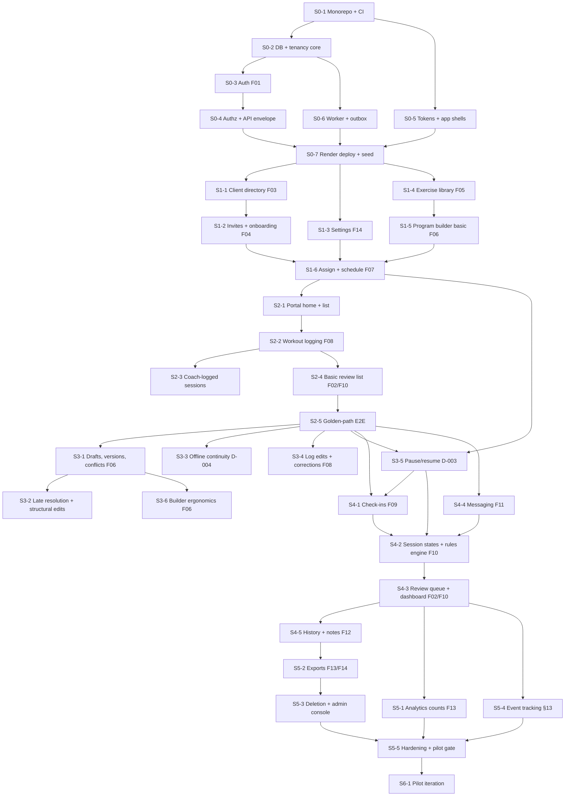

# Repsy R1 Implementation Plan

> **For agentic workers:** REQUIRED SUB-SKILL: Use superpowers:subagent-driven-development (recommended) or superpowers:executing-plans to implement this plan task-by-task. Steps use checkbox (`- [ ]`) syntax for tracking.

**Goal:** Ship Repsy R1, a pilot-ready coaching loop: invite client → assign program → log workout → identify attention needed → complete check-in → take the next action.

**Architecture:** pnpm monorepo. `apps/web` is Next.js App Router with Better Auth, serving UI and `/api/v1`. `apps/worker` is an always-on pg-boss worker. `packages/core` holds domain logic behind adapters. `packages/db` holds Prisma + PostgreSQL. `web` deploys as a Render Web Service and `worker` as a Render Background Worker, on one Render Postgres (D-005). Build order is "thin loop first, then deepen" (D-009): the golden-path E2E passes from the end of Sprint 2 and stays green.

**Tech Stack:** TypeScript (strict), Next.js App Router, React, Tailwind CSS, shadcn/ui + Radix, React Hook Form + Zod, Prisma, PostgreSQL, Better Auth, pg-boss, Resend (behind an adapter), Cloudflare R2 / S3-compatible storage, Sentry, PostHog, Vitest, React Testing Library, Playwright + @axe-core/playwright, GitHub Actions, Render (`render.yaml` Blueprint), `date-fns` + `@date-fns/tz` for timezone math, `idb` for IndexedDB.

**Spec:** the original coaching platform PRD (v1.0, .docx, kept outside the repo) as amended by [`docs/decisions.md`](decisions.md) (D-001…D-010). **decisions.md wins every conflict.** Executors read both.

---

## How this plan is organized

1. **Global Constraints** and **Review Focus** apply to every ticket.
2. **Dependency graph**: ticket order and parallelism.
3. **Data model**: the target schema, so no sprint builds a disposable model (D-009 rule 1).
4. **Tickets by sprint (S0–S6)**: each with PRD Fxx and decision refs, scope, interfaces and the tests that prove it.
5. **Sprint 0 step-level tasks**: ready to execute now.
6. **Later sprints**: at the start of each sprint, run `superpowers:writing-plans` against that sprint's tickets to produce `docs/superpowers/plans/<date>-sprint-N.md` with step-level tasks. The tickets below fix the scope, interfaces and tests. The sprint plan adds the step granularity, using the code that exists by then.

---

## Global Constraints

- TypeScript `strict: true`; ESLint + Prettier; no `any` in `packages/core`.
- Use stable releases current at implementation time; pin exact versions in `pnpm-lock.yaml`; Node.js active LTS pinned in `.nvmrc` and `engines` (PRD §7).
- Every read and write is scoped to the actor's active organization and membership; **never trust `organization_id` from the client UI** (PRD §7.2, D-006).
- Every tenant-owned table carries `organization_id`; parent and child tenant IDs must match (PRD §8.1, D-008 schema fixes).
- UTC storage, client-local rendering. Scheduled items also store the intended local calendar date (D-010 #1).
- API: prefix `/api/v1`; envelope `{data, meta?, error?}`; errors `{code, message, fieldErrors?, requestId}`; statuses 400/401/403/404/409/422/429/500; CSRF protection on mutations (PRD §9).
- Idempotency keys on submissions, invitations, exports and jobs; retries use exponential backoff (PRD §7.2).
- Cursor-based pagination for lists; indexes on `organization_id`, `client_id`, `due_at`, `created_at`, `status` (PRD §7.2).
- `packages/core` never imports provider SDKs (Resend, S3, PostHog, Sentry, pg-boss). Use adapters (PRD §7.1).
- Workout logging and sync never depend on the worker (D-005 rule 4).
- No AI features, no generated health advice, no medical-clearance claims, no injury or medical-history fields (Operating rules, D-007).
- Review flag severity copy is "Needs review", never "At risk" (F10).
- Sync status copy on the workout screen: **"Saved on device"**, **"Syncing"**, **"Synced"** (D-004 #6).
- Colors: Canvas `#F7F8F6`, Surface `#FFFFFF`, Primary ink `#152825`, Accent `#1C7666`, Accent hover `#145B50`, Secondary text `#60716E`, Divider `#E1E8E4` (decorative only), Input border `#7D8C87`, Warning `#8F5A26`, Danger `#B64743`. Radius 12px cards, 8px controls. Shadow `0 4px 18px rgba(16,36,30,.05)`. Spacing 4/8/12/16/24/32 (PRD §6.2, D-008 #18).
- Typography: page titles 28–32px desktop, 24px mobile; section 18px; body 14–16px; metadata ≥12px. Motion 120–180ms, honor `prefers-reduced-motion`. Tap targets ≥44px on mobile. Target: WCAG 2.2 AA (PRD §6.2).
- Viewports: 375 / 768 / 1440 with no horizontal clipping (PRD §12).
- No hardcoded domain. Base URL, auth URL, OAuth callbacks and email link base come from env (`APP_BASE_URL`, `BETTER_AUTH_URL`, …). Never a hardcoded domain (D-010 #5).
- No secrets in Git or docs. Only `.env.example` with placeholders. Synthetic seed data only (PRD §15.2, D-010 #5).
- Analytics never captures names, free-text answers, message bodies or wellbeing answers. Client IDs are hashed (PRD §13, D-007).
- Audit events never contain message content (PRD §11).
- A slice is done only with: functionality, loading/error/empty states, responsive UX, permission checks, tests, docs (D-009 rule 3).
- Definition of done per PR: `pnpm lint && pnpm typecheck && pnpm test && pnpm test:e2e` green, including axe checks on touched screens (PRD §15.2).
- From the end of Sprint 2, `e2e/golden-path.spec.ts` must pass on every PR (D-009 rule 2).
- Pilot numbers: grace default 24h, range 0–72h; client log edit window 24h; invite expiry 7 days; max 30 active clients per coach; password ≥12 chars + breached check; snooze 1 day / 3 days / 1 week / custom; check-ins issued 06:00 local, due 23:59 local; workouts due 23:59 local; deletion target 30 days; backups expire within 35 days (D-008, D-010).

## Review Focus

Each item is pinned by a test in the named ticket.

1. **DST and timezone boundaries.** A client in `America/New_York` with sessions spanning the 2026-11-01 DST end, and a coach in a different timezone than the client, must see the same local dates the client sees. Due remains 23:59 client-local. _Test in S1-6 (`scheduleSlots` DST case) and S4-2 (missed sweep at a boundary)._
2. **Replay and duplicate submission.** The same set log or completion sent 3× (network retry, outbox replay after reload, double tap) produces exactly one row and one completion. _Test in S2-2 (API idempotency) and S3-3 (outbox replay)._
3. **Dual-role and guessed IDs.** A user who is owner of org A and client of org B must not reach org B coach data or org A data as a client, including by swapping IDs in URLs and API bodies. _Test in S0-4 harness and S1-2._
4. **Coach edits while client mid-workout.** A coach commits a new version while the client has started a session (online or offline). The client keeps the locked version, and the sync still succeeds. _Test in S3-1/S3-3 (`started session keeps locked version after commit`)._
5. **Unit round-trip.** A client in lb enters 135 lb, which is stored as kg. Re-display shows 135 lb, not 134.9, and the coach in kg sees 61.2 kg. _Test in S2-2 (`units round-trip`)._

---

## Dependency graph



**Parallelism (independent files):** S0-5 ∥ S0-2/S0-3; S0-6 ∥ S0-3/S0-4. S1-3 ∥ S1-4 ∥ S1-1. S3-3 ∥ S3-4 ∥ S3-1. S4-4 ∥ S4-1. S5-1 ∥ S5-2 ∥ S5-4. Only one writer touches `packages/db/prisma/schema.prisma` at a time: **schema changes are serialized**, and parallel tickets rebase migrations.

---

## Target data model (`packages/db/prisma/schema.prisma`)

Every model listed with † carries `organizationId` and indexes on it. Enums in `snake_case` values. Introduce models in the sprint that first needs them, but **in this shape**. Don't add temporary ones.

| Model                                | Key fields                                                                                                                                                                                                                                                                                                                                                                                    | Sprint | Refs                 |
| ------------------------------------ | --------------------------------------------------------------------------------------------------------------------------------------------------------------------------------------------------------------------------------------------------------------------------------------------------------------------------------------------------------------------------------------------- | ------ | -------------------- |
| `User`                               | id, email (unique, normalized), name, emailVerified, isPlatformAdmin, lastLoginAt                                                                                                                                                                                                                                                                                                             | 0      | F01, D-006           |
| `Session`, `Account`, `Verification` | Better Auth's generated tables (DB sessions, OAuth accounts, tokens)                                                                                                                                                                                                                                                                                                                          | 0      | D-006                |
| `Organization`                       | id, name, timezone, plan (`pilot`), ownerUserId, graceHours (default 24, 0–72), activeClientLimit (30)                                                                                                                                                                                                                                                                                        | 0      | F01, D-008 #5/#13    |
| `Membership`                         | userId, organizationId, role (`owner`/`coach`/`client`), status; unique (userId, organizationId, role)                                                                                                                                                                                                                                                                                        | 0      | F01, D-006           |
| `PilotCode`                          | codeHash, createdBy, usedBy?, usedAt?, expiresAt                                                                                                                                                                                                                                                                                                                                              | 0      | D-008 #19            |
| `AuditEvent`†                        | actorId, objectType, objectId, action, metadataJson (no content), requestId, createdAt; append-only                                                                                                                                                                                                                                                                                           | 0      | §11                  |
| `OutboxEmail`†                       | kind, toUserId, templateKey, payloadJson, idempotencyKey (unique), status, attempts, sentAt                                                                                                                                                                                                                                                                                                   | 0      | D-005                |
| `NotificationPreference`             | userId, messageEmailOptIn (default false), marketingOptIn (default false)                                                                                                                                                                                                                                                                                                                     | 1      | D-008 clar. 3        |
| `CoachProfile`                       | userId, bio, specialties, units                                                                                                                                                                                                                                                                                                                                                               | 1      | F14                  |
| `Client`†                            | id, userId?, coachUserId, status (`invited`/`active`/`paused`/`archived`), startDate, goals, timezone, preferredUnits (`kg`/`lb`), consentVersion?, consentAt?, checkinWeekday?, checkinTemplateId?                                                                                                                                                                                           | 1      | F03, D-007           |
| `ClientInvite`†                      | clientId, tokenHash, expiresAt (+7d), acceptedAt?, revokedAt?, idempotencyKey                                                                                                                                                                                                                                                                                                                 | 1      | F04, D-008 #14       |
| `Exercise`                           | organizationId? (null = seeded global), name, equipment, muscleGroup, movementType, trackingType (`reps_load`/`duration`/`distance`), instructions, mediaUrl?                                                                                                                                                                                                                                 | 1      | F05, D-008 #8        |
| `Program`†                           | id, title, kind (`template`/`client`), clientId?, sourceProgramId?, sourceVersionId?, currentVersionId?, status, createdBy                                                                                                                                                                                                                                                                    | 1      | D-001                |
| `ProgramVersion`†                    | programId, versionNo (unique per program), committedBy, committedAt, daysPerWeek, weekCount                                                                                                                                                                                                                                                                                                   | 1      | D-001, D-002         |
| `ProgramSlot`†                       | programVersionId, weekIndex, dayIndex, workoutVersionId; unique (programVersionId, weekIndex, dayIndex)                                                                                                                                                                                                                                                                                       | 1      | D-002 #2             |
| `WorkoutVersion`†                    | id, title, notes; immutable                                                                                                                                                                                                                                                                                                                                                                   | 1      | D-002 #1             |
| `WorkoutVersionExercise`†            | workoutVersionId, exerciseId, position, targetJson (Zod-validated: sets[{reps?, loadKg?, rpe?, restSec?, tempo?, durationSec?, distanceM?}]), note                                                                                                                                                                                                                                            | 1      | F06                  |
| `ProgramDraft`†                      | programId, baseVersionNo, draftJson, updatedAt, updatedBy                                                                                                                                                                                                                                                                                                                                     | 3      | D-002 #3             |
| `ProgramAssignment`†                 | clientId, programId (client copy), startLocalDate, weekdays (int[] ISO 1–7), timezone, status (`active`/`ended`/`completed`), readinessConfirmedAt/By, endedAt; partial unique (clientId) where status=`active`                                                                                                                                                                               | 1      | F07, D-010 #2, D-007 |
| `WorkoutSession`†                    | assignmentId, clientId, slotWeekIndex, slotDayIndex, scheduledLocalDate, scheduledAt (UTC), dueAt (UTC), state (`scheduled`/`in_progress`/`completed`/`skipped`/`missed`/`incomplete`/`cancelled`), workoutVersionId? (null until locked), startedAt?, completedAt?, submittedAt?, comment?, loggedByUserId?, pauseOffsetDays (default 0); unique (assignmentId, slotWeekIndex, slotDayIndex) | 1      | D-002, D-008 #4/#7   |
| `SetLog`†                            | sessionId, workoutVersionExerciseId, setIndex, reps?, weightKg?, rpe?, durationSeconds?, distanceM?, clientUpdatedAt, clientMutationId; unique (sessionId, workoutVersionExerciseId, setIndex)                                                                                                                                                                                                | 2      | D-004 #7, D-008 #8   |
| `SetLogRevision`†                    | setLogId, before/after json, reason, revisedBy, createdAt                                                                                                                                                                                                                                                                                                                                     | 3      | D-008 #6, clar. 2    |
| `ClientPause`†                       | clientId, startLocalDate, resumeLocalDate, appliedOffsetDays, endedAt?, createdBy                                                                                                                                                                                                                                                                                                             | 3      | D-003                |
| `CheckinTemplate`†                   | title, questionSchema (Zod: [{id, type: `scale_1_5`/`short_text`/`yes_no`, label, optional: true}]), isSeeded                                                                                                                                                                                                                                                                                 | 4      | F09, D-008 #9        |
| `Checkin`†                           | clientId, templateId, periodLocalDate, issuedAt, dueAt, submittedAt?, answersJson?, draftJson?; unique (clientId, periodLocalDate)                                                                                                                                                                                                                                                            | 4      | D-010 #3             |
| `ReviewFlag`†                        | clientId, ruleKey (`missed_workouts`/`checkin_overdue`/`checkin_new`/`message_unread`/`coach_followup`), severity (`needs_review`), sourceType, sourceId, dedupeKey (unique), evidenceJson, state (`open`/`snoozed`/`resolved`/`dismissed`), snoozedUntil?, resolvedBy?, resolvedAt?, resolutionReason?, reopenedAt?                                                                          | 4      | F10, D-008 #11       |
| `ConversationThread`†                | clientId (unique), coachUserId                                                                                                                                                                                                                                                                                                                                                                | 4      | F11                  |
| `Message`†                           | threadId, senderUserId, body, createdAt, readAt?; immutable                                                                                                                                                                                                                                                                                                                                   | 4      | F11, D-008 #1        |
| `InternalNote`†                      | clientId, authorUserId, body                                                                                                                                                                                                                                                                                                                                                                  | 4      | F12                  |
| `ExportJob`†                         | requestedBy, scope (`client_self`/`org`), resourceType, status, objectKey?, expiresAt?, idempotencyKey                                                                                                                                                                                                                                                                                        | 5      | F13, D-010 #4        |
| `DeletionRequest`†                   | subjectUserId, subjectClientId?, requestedBy, status (`requested`/`verified`/`processing`/`done`/`rejected`), legalHold, verifiedBy?, completedAt?                                                                                                                                                                                                                                            | 5      | Journey E, D-008 #16 |
| `SupportAccessGrant`                 | adminUserId, clientId, reason, expiresAt                                                                                                                                                                                                                                                                                                                                                      | 5      | D-006 roles          |

---

## Tickets by sprint

Ticket format: **ID — title** · PRD refs · decision refs · depends on. Then scope, interfaces, and the tests that prove it.

### Sprint 0 — Foundations (DoD: preview/staging deploy; unit + security baseline)

**S0-1 — Monorepo, tooling, CI** · §7, §7.2, §15.2 · D-009 · none
Scope: pnpm workspaces (`apps/web`, `apps/worker`, `packages/core`, `packages/db`), shared `tsconfig.base.json` (strict), ESLint/Prettier, Vitest workspace, Playwright in `apps/web`, root scripts `lint`/`typecheck`/`test`/`test:e2e`, GitHub Actions with a Postgres service container, `.env.example`, `.nvmrc`, README skeleton.
Tests: CI runs all four scripts green on an empty-but-wired repo.

**S0-2 — Database package + tenancy primitives** · §8, §8.1, §7.2 · D-006, D-008 · S0-1
Scope: Prisma setup; models `User`, `Organization`, `Membership`, `PilotCode`, `AuditEvent`, `OutboxEmail`; Better Auth tables (generated in S0-3 but migrated here or there, one migration owner); `createTestDb()` helper (schema per test file); `tenantScope(orgId)` query helper; `appendAudit()`.
Interfaces: `packages/db`: `prisma: PrismaClient`, `withTenant<T>(orgId: string, fn: (tx: TenantTx) => Promise<T>): Promise<T>`, `appendAudit(tx, e: AuditInput): Promise<void>`.
Tests: `tenant.test.ts`: a query through `withTenant(orgA)` never returns org B rows; `audit.test.ts`: audit rows can't be updated (DB trigger or repository has no update path).

**S0-3 — Authentication (F01)** · F01, §11 · D-006, D-008 #15/#19, D-010 #5 · S0-2
Scope: Better Auth with Prisma adapter, DB sessions, httpOnly secure cookies; email/password with min length 12 + breached-password plugin; required email verification; email reset; Google OAuth (env-configured, disabled when env is missing); rate limit on sign-in; session revocation (sign out all / admin revoke). Coach sign-up requires a valid unused `PilotCode` and creates an `Organization` + `owner` membership + `CoachProfile` in one transaction. Pages `/signup`, `/login`, `/verify-email`, `/reset-password`. Emails via `EmailPort` → outbox.
Interfaces: `apps/web/src/lib/auth.ts` exports `auth` (Better Auth instance); `getSessionUser(headers): Promise<SessionUser | null>`.
Tests: integration: signup without pilot code → 422 `PILOT_CODE_INVALID`; password of 11 chars rejected; unverified user is redirected from `/app` to `/verify-email`; revoked session → 401 on next request; reset token single-use. E2E: `auth.spec.ts` signup → verify (read link from dev email sink) → `/app`.

**S0-4 — Authorization + API conventions** · §7.2, §9, §11 · D-006 · S0-3
Scope: `ActorContext` resolution (user + active membership + platform admin), policy helpers in `packages/core/authz`, route-handler wrapper producing the envelope, `requestId`, structured error codes, Zod input parsing → 422 with `fieldErrors`, CSRF/origin check on mutations, per-route rate limiting. Cross-tenant test harness that seeds two orgs + a dual-role user.
Interfaces:

- `packages/core/src/authz/actor.ts`: `type ActorContext = { userId: string; orgId: string; role: 'owner'|'coach'|'client'; clientId?: string; isPlatformAdmin: boolean }`
- `apps/web/src/server/api.ts`: `apiHandler<I, O>(opts: { input?: ZodType<I>; roles: Role[] }, fn: (ctx: ActorContext, input: I) => Promise<O>)`
- `apps/web/test/harness/tenants.ts`: `seedTwoTenants(): Promise<{ orgA, orgB, coachA, coachB, clientA, dualRoleUser }>`
  Tests: `cross-tenant.test.ts`: coach B GET of org A resource → 404 (not 403, no existence leak); client role → 403 on coach routes; `dualRoleUser` acting as client of B can't read A's data. Errors always include `requestId`.

**S0-5 — Design tokens + app shells** · §6, §6.1, §6.2 · D-008 #18 · S0-1
Scope: Tailwind theme from Global Constraints tokens; shadcn base (Button, Input, Card, Tabs, Dialog, Toast, Skeleton); `EmptyState`, `ErrorState`, `LoadingState` primitives; coach layout (desktop left nav: Overview, Clients, Programs, Review, Messages, Analytics, Settings pinned bottom; mobile bottom nav: Home, Clients, Review, Messages, More); portal layout (Home, Workouts, Check-ins, Messages, Profile); breadcrumbs; reduced-motion.
Tests: `tokens.test.ts` asserts contrast: Warning `#8F5A26` ≥4.5:1 on `#FFFFFF`, Input border `#7D8C87` ≥3:1 on `#FFFFFF` and `#F7F8F6`; E2E `shell.spec.ts` axe has no violations at 375/1440 for both shells.

**S0-6 — Worker, jobs, outbox, observability** · §7.1 · D-005, D-010 #5 · S0-2
Scope: `apps/worker` boots pg-boss, registers jobs from a registry, graceful shutdown; `defineJob()` wrapper (idempotency key, retry with exponential backoff, Sentry capture); outbox delivery job `email.deliver`; `EmailPort` with `ResendEmailAdapter` and `DevSinkEmailAdapter` (writes to the `dev_emails` table / file; used in dev and CI); Sentry in web + worker; pino structured logs with requestId; `/healthz` on both.
Interfaces: `packages/core/src/ports/email.ts`: `interface EmailPort { send(msg: EmailMessage): Promise<{ providerId: string }> }`; `packages/core/src/outbox.ts`: `enqueueEmail(tx, input: { kind; toUserId; templateKey; payload; idempotencyKey }): Promise<void>`; `apps/worker/src/jobs/registry.ts`: `defineJob<P>(name: string, handler: (p: P) => Promise<void>, opts?: { retryLimit?: number; cron?: string })`.
Tests: same `idempotencyKey` enqueued twice → one row; delivery failure retries and marks `failed` after the limit; a handler throwing on attempt 1 succeeds on attempt 2 without double-send.

**S0-7 — Render deploy, seed, smoke** · §7, §17 · D-005, D-010 #5 · S0-4, S0-5, S0-6
Scope: `render.yaml` Blueprint (founder creates the Render account, connects GitHub and sets env): Web Service `web` (paid Starter+), Background Worker `worker`, Render Postgres (paid); staging and production environments; `prisma migrate deploy` as the pre-deploy command using the owner connection; SQL that creates the non-owner runtime role `repsy_app` (`NOSUPERUSER NOBYPASSRLS`) with grants, plus a startup check in web and worker that refuses to run as the table owner, a superuser or a `BYPASSRLS` role; pg-boss schema created with the owner connection; client IP from Render's proxy hop in `X-Forwarded-For`; high-entropy pilot-code generator (≥128 bits, shown once, stored sha256); synthetic seed (`pnpm db:seed`: 1 admin, 1 pilot code, demo coach + 3 clients; no real-looking PII); smoke Playwright against the staging URL from env; `docs/architecture/overview.md` with the diagram; `docs/runbook.md` (deploy, rollback, migration, restore placeholder).
Tests: CI job `smoke` (manual trigger) hits `${STAGING_URL}/healthz` and logs in as the seeded demo coach.

### Sprint 1 — Clients + basic programming (DoD: full coach/client access tests)

**S1-1 — Client directory (F03)** · F03, §6 `/app/clients` · D-007, D-008 #13 · S0-7
Scope: `Client` model; create client (name, email, goals; timezone/units are set by the client at onboarding, defaulting to the org's); roster with search (name/email), status filter, cursor pagination; client page header + tabs Overview/Program/Sessions/Check-ins/Messages/Notes (tabs empty-state until their ticket); limit of 30 **active** clients → 409 `CLIENT_LIMIT_REACHED` with "Pilot access" copy.
API: `GET/POST /api/v1/clients`, `GET/PATCH /api/v1/clients/:id`.
Tests: the 31st activation is rejected; search is case-insensitive; cross-tenant 404; client role can't list.

**S1-2 — Invitations + onboarding (F04)** · F04, §8 `client_invites` · D-006, D-007, D-008 #14 · S1-1
Scope: `ClientInvite`; issue (hashed token, `expiresAt = now + 7d`, idempotency key), resend (revokes prior), revoke; email via outbox; `/invite/[token]` accept: sign in or sign up (email verification still required), privacy explanation + consent (stores `consentVersion`, `consentAt`), units, timezone (browser default, editable), goals; creates the `client` membership; existing users link without a duplicate account; coach sees pending/accepted/expired.
API: `POST /api/v1/clients/:id/invite`, `POST /api/v1/auth/invite/accept`.
Tests: expired → 410 `INVITE_EXPIRED`; reused → 410 `INVITE_USED`; revoked-by-resend → 410; existing user who is owner of another org accepts → gains client membership, same `User.id` (Review Focus #3); audit `invite.accepted`.

**S1-3 — Settings + pilot plan display (F14 part)** · F14, §6 `/settings` · D-008 #5/#10/#12/#13 · S0-7
Scope: coach profile, org name/timezone/units, `graceHours` (0–72, default 24), notification preferences (message email opt-in default **off**; marketing separate, default off; transactional not toggleable), "Pilot access" card with limits (30 active clients); client account page (units, timezone, notifications). Data export/deletion entry points are placeholders until S5.
API: `GET/PATCH /api/v1/settings`.
Tests: `graceHours: 73` → 422; client cannot PATCH org settings.

**S1-4 — Exercise library (F05)** · F05 · D-008 #8 · S0-7
Scope: seed ≈80 generic exercises (synthetic descriptive instructions, no third-party media) with `trackingType`; custom exercises per org with optional media link (URL validated, https only); search, filter by muscle group/equipment/tracking type, sort by name.
API: `GET/POST /api/v1/exercises`.
Tests: org A custom exercise is invisible to org B; seeded exercises visible to all; `mediaUrl: "javascript:..."` → 422.

**S1-5 — Program builder, basic (F06 subset)** · F06, §6 `/app/programs` · D-001, D-002 · S1-4
Scope: template programs list + create; simple editor (weeks × ordered training days; each day has a workout with exercises and per-set targets, validated by `targetSchema`); **Save** commits a `ProgramVersion` with `ProgramSlot`s and `WorkoutVersion`s, reusing unchanged workout versions (structural sharing). No drafts/autosave yet (S3-1); the UI states "Save to keep changes". Every week must have the same number of training days (D-010 #1 builder call), enforced on save.
Interfaces: `packages/core/src/programs/commit.ts`: `commitProgramVersion(tx, ctx: ActorContext, input: { programId: string; expectedVersionNo: number | null; weeks: WeekInput[] }): Promise<{ versionNo: number; versionId: string }>`; `packages/core/src/programs/targets.ts`: `targetSchema: ZodType<WorkoutTargets>`.
API: `GET/POST /api/v1/programs`, `GET/PATCH /api/v1/programs/:id` (PATCH carries `expectedVersion`; 409 on mismatch, see S3-1 for UI).
Tests: changing one workout in a 4×3 program creates exactly 1 new `WorkoutVersion` and 12 slots pointing at 11 old + 1 new; `expectedVersionNo` stale → `VersionConflictError`.

**S1-6 — Assignment + scheduling (F07)** · F07, §10 · D-001, D-002 #4, D-007, D-010 #1/#2 · S1-2, S1-3, S1-5
Scope: assign dialog: client, start date, weekdays (must equal `daysPerWeek`, distinct), readiness checkbox (required on a client's first assignment), replacement confirmation if an active assignment exists; copy-on-assign deep copy into a `kind=client` `Program` with version 1 (the copy shares `WorkoutVersion` rows, since they're immutable); session generation in one transaction; replacement ends the old assignment and cancels its unstarted sessions dated ≥ new start; audit `assignment.created` / `assignment.replaced`.
Interfaces:

- `packages/core/src/schedule/scheduleSlots.ts`: `scheduleSlots(input: { slots: SlotKey[]; weekdays: IsoWeekday[]; startLocalDate: string /* YYYY-MM-DD */; timeZone: string }): ScheduledSlot[]` where `ScheduledSlot = { slot: SlotKey; localDate: string; scheduledAtUtc: Date; dueAtUtc: Date }`. `scheduledAtUtc` = 00:00 local, `dueAtUtc` = 23:59 local, both converted with `@date-fns/tz`.
- `packages/core/src/assignments/assign.ts`: `assignProgram(tx, ctx, input: { clientId; templateProgramId; startLocalDate; weekdays; readinessConfirmed: boolean; confirmReplace: boolean }): Promise<{ assignmentId: string; sessionCount: number }>`
  Tests (`scheduleSlots.test.ts`):
- Day 1–3, weekdays Mon/Wed/Fri `[1,3,5]`, start Wed `2026-11-04` → W1D1 `2026-11-04`, W1D2 `2026-11-06`, W1D3 `2026-11-09`, W2D1 `2026-11-11`.
- DST: tz `America/New_York`, Sun-only `[7]`, start `2026-10-25` → slot 2 on `2026-11-01` has `dueAtUtc` `2026-11-02T04:59:00Z` (EST), slot 1 `dueAtUtc` `2026-10-26T03:59:00Z` (EDT). (Review Focus #1)
- weekdays count ≠ daysPerWeek → `ScheduleInputError`.
  Tests (`assign.test.ts`): second assignment without `confirmReplace` → 409 `ACTIVE_ASSIGNMENT_EXISTS`; with it → old `ended`, unstarted sessions ≥ start `cancelled`, `completed`/`in_progress` untouched; missing readiness on first assignment → 422.

### Sprint 2 — First end-to-end loop (DoD: golden path E2E green)

**S2-1 — Portal home + workout list (§4)** · §4, §6 `/portal` · D-002 #5, D-007 #5 · S1-6
Scope: home with "Next workout" large CTA, this week's progress (n of m), safety reminder before the first program starts ("Tell your coach about anything that affects safe training before you begin."); chronological list; unstarted session shows the workout resolved via the assignment's current program version (`resolveSessionWorkout`).
Interfaces: `packages/core/src/sessions/resolve.ts`: `resolveSessionWorkout(tx, sessionId): Promise<WorkoutVersionView>` (locked version if set, else current version's slot).
Tests: an unstarted session reflects a newly committed version; cancelled sessions hidden; empty state when no assignment.

**S2-2 — Workout logging, online (F08)** · F08, Journey C, §9.1 · D-002 #6, D-004 #7, D-008 #4/#8 · S2-1
Scope: `/portal/workouts/[sessionId]`: **Start Workout** locks `workoutVersionId` and sets `in_progress`; per-set entry by tracking type with previous performance shown; per-set save with visible status; complete or skip (skip locks version too) with optional comment; units display/convert at the edge (`toDisplay`, `fromDisplay`); 44px targets.
API: `POST /api/v1/sessions/:id/start`, `POST /api/v1/sessions/:id/logs` (PRD §9.1 payload; validation 0≤reps≤1000, 0≤weightKg≤2000, 1≤rpe≤10, exercise must belong to the locked version), `POST /api/v1/sessions/:id/complete` and `/skip` with `idempotencyKey`.
Interfaces: `packages/core/src/logging/upsertSetLogs.ts`: `upsertSetLogs(tx, ctx, sessionId, items: SetLogInput[]): Promise<SetLogAck[]>` (upsert on unique key; ignores writes whose `clientUpdatedAt` is older than stored); `packages/core/src/units.ts`: `toDisplay(kg: number, unit: 'kg'|'lb'): number`, `fromDisplay(v: number, unit): number`. Store `weightKg` as `Decimal(7,3)`; display rounds to 1 dp for lb, 1 dp for kg.
Tests: same payload ×3 → 1 row per set, 1 completion (Review Focus #2); `rpe: 11` → 422; exercise not in version → 422; **units round-trip**: `fromDisplay(135,'lb')` stored then `toDisplay(...,'lb') === 135` and `toDisplay(...,'kg') === 61.2` (Review Focus #5); a client of org B can't log against org A's session (404).

**S2-3 — Coach-logged sessions** · F08 · D-008 #7 · S2-2
Scope: from client Sessions tab, coach can start/log/complete on the client's behalf; `loggedByUserId` set; "Logged by coach" badge in coach and client views; audit `session.logged_by_coach`.
Tests: badge visible to client; client still can't log for others.

**S2-4 — Basic review list + dashboard (F02/F10 subset)** · F02, F10 · D-009 Sprint 2 scope · S2-2
Scope: `/app` and `/app/review` show counts and simple lists: new completed sessions (since the coach last viewed), sessions due this week, skipped this week; each item links to client + session. **No `ReviewFlag` rows in Sprint 2.** The list is read queries over `WorkoutSession`, which avoids a throwaway flag type; `ReviewFlag` arrives in S4-2.
Tests: completing a session appears in the coach's list within the same request cycle; another org's completions never appear.

**S2-5 — Golden-path E2E** · Journeys A + C · D-009 rule 2 · S2-4
Scope: `apps/web/e2e/golden-path.spec.ts`: coach signs up (pilot code from seed) → verifies email (dev sink) → invites client → client accepts in a second browser context → coach creates a 1-week × 1-day program with 3 exercises → assigns (weekday = today's weekday, start today) → client starts workout → logs sets for 3 exercises → completes → coach review list shows the completion. Required check in CI from here on.

### Sprint 3 — Reliable workout experience (DoD: autosave/reload/conflict tests; offline acceptance)

**S3-1 — Drafts, autosave, versions, conflicts (F06, Journey B)** · F06, Journey B, §9.1 · D-001, D-002 #3 · S2-5
Scope: `ProgramDraft` autosave (debounced 800ms, `saving`/`saved`/`offline`/`error` indicator); explicit **Save changes** commits; on client programs show D-001 confirmation copy verbatim ("This update will apply only to upcoming workouts. Completed and already-started workouts will remain unchanged."); version history list (who/when, view read-only); 409 conflict notice with "Reload latest" and the draft kept; last logged performance rail beside each exercise for client programs (`GET /api/v1/clients/:id/history`).
Tests: refresh mid-edit restores draft; two tabs commit → second gets 409, nothing overwritten; **started session keeps locked version after commit** (Review Focus #4); E2E `journey-b.spec.ts`.

**S3-2 — Late resolution + structural edits** · F06, F07 · D-002 #5/#7 · S3-1
Scope: on commit of a client program, removed slots → their unstarted sessions `cancelled`; added slots → sessions generated via `scheduleSlots` continuing the assignment's weekday sequence; audit `program.version_committed` with slot diff counts.
Interfaces: `reconcileSessions(tx, assignmentId, fromVersionId, toVersionId): Promise<{ cancelled: number; created: number }>`.
Tests: remove W3D2 → only unstarted W3D2 cancelled; completed W1 untouched.

**S3-3 — Offline continuity (D-004)** · F08, Journey C, §12 · D-004 · S2-5
Scope: on Start (online) cache the resolved locked workout in IndexedDB; outbox store of mutations keyed by `clientMutationId`; sync loop on `online`/visibility/interval with backoff; status chip: "Saved on device" → "Syncing" → "Synced" (only after server ack); completion offline is queued; minimal service worker caching only the portal shell, static assets and `/portal/workouts/[id]` for in-progress sessions; Start is disabled offline for uncached sessions with explanation.
Interfaces: `apps/web/src/portal/offline/outbox.ts`: `enqueue(m: Mutation): Promise<void>`, `flush(): Promise<FlushResult>`, `status$: Observable<'saved_on_device'|'syncing'|'synced'>`.
Tests: E2E `offline.spec.ts` (D-004 acceptance): start online → `context.setOffline(true)` → log every set → complete → close page, open new page offline (shell loads from SW) → progress present → go online → server has exact set rows once, session `completed` once (Review Focus #2); coach commits a new version while the client is offline → sync still succeeds against the locked version (Review Focus #4).

**S3-4 — Log edit window + coach corrections (F08)** · F08, §8.1 · D-008 #6, clar. 2 · S2-5
Scope: client edits a submitted log until `submittedAt + 24h` (then 403 `EDIT_WINDOW_CLOSED`); coach correction any time with a required reason → `SetLogRevision` + audit; the history shows the revision trail; the workout version is never altered.
Tests: edit at 23h59m ok, at 24h01m rejected (fake clock); correction without reason → 422.

**S3-5 — Pause / resume (D-003)** · F03, F07 · D-003 · S1-6, S2-5
Scope: pause dialog (start date, expected resume date, D-003 confirmation copy verbatim); shift unstarted sessions dated ≥ pause start by N calendar days in client tz (recompute `scheduledAt`/`dueAt` from `scheduledLocalDate`); `ClientPause.appliedOffsetDays`; edit resume date applies only the delta; early resume pulls back unused days; client status `paused`; portal banner "Program paused" + resume date.
Interfaces: `applyPause(tx, ctx, input: { clientId; startLocalDate; resumeLocalDate }): Promise<{ shifted: number }>`, `updatePause(...)`, `resumeNow(...)`.
Tests: running `applyPause` twice shifts once; Week 3 Monday resumes as Week 3; DST-crossing shift keeps 23:59 local; completed/in_progress sessions unchanged.

**S3-6 — Builder ergonomics (F06)** · F06 · D-001 · S3-1
Scope: duplicate week, duplicate workout, reorder exercises/days via accessible controls (move up/down buttons + keyboard), persistent exercise notes, templates list shows "used by N clients" (read-only, no bulk push).
Tests: keyboard-only reorder E2E; duplicate week produces new slots sharing workout versions.

### Sprint 4 — Complete coaching workflow (DoD: full closed-loop E2E)

**S4-1 — Check-ins (F09)** · F09, §4 check-in · D-007, D-008 #9, D-010 #3 · S2-5, S3-5
Scope: seeded editable template per coach (questions optional; types `scale_1_5`/`short_text`/`yes_no`; seeded: energy, sleep, stress, satisfaction, "What got in the way this week?", free text); coach sets the client's weekday + template; worker job `checkins.issue` (every 10 min) creates the check-in at 06:00 local on the weekday, skipped while paused; "check-in ready" email via outbox; portal form with autosaved draft (local + server), submission confirmation; coach view beside last week's activity.
Tests: sweep ×3 at the same instant → one check-in (unique `(clientId, periodLocalDate)`); paused week → none; weekday change applies next period only; submit ×2 with the same `idempotencyKey` → one submission; all questions omitted → valid submission; partial draft survives reload.

**S4-2 — Session state derivation + rules engine (F10)** · F10, §10 · D-005, D-008 #4/#5/#11, D-010 · S3-5, S4-1, S4-4
Scope: worker `review.sweep` every 10 minutes: unstarted past `dueAt + graceHours` → `missed`; `in_progress` past → `incomplete` (version stays locked); Rule 1: ≥2 `missed` with `dueAt` in rolling 7 days, excluding paused/cancelled → `missed_workouts` flag citing both sessions; Rule 2: check-in past `dueAt + grace` unsubmitted → `checkin_overdue`, auto-resolved in the submit transaction; Rule 3: on submit (same transaction) → `checkin_new`; Rule 4: client message unread >24h and coach opted in → `message_unread`; coach-created follow-up → `coach_followup`. `dedupeKey` per rule+source(+window); evidence JSON lists rule text, client, dates and source IDs. Late-synced completion (offline) of a session already marked `missed` sets `completed` and re-evaluates Rule 1 (auto-resolves if no longer met).
Interfaces: `packages/core/src/review/rules.ts`: `evaluateRules(tx, orgId, now: Date): Promise<{ opened: number; resolved: number }>`; each rule `Rule = { key: RuleKey; evaluate(tx, orgId, now): Promise<FlagUpsert[]> }`.
Tests: two missed + one skipped → flag; one missed + one incomplete → no flag; paused period → no flag; sweep twice → one flag; timezone boundary: session due 23:59 `Pacific/Auckland` with 0h grace becomes missed at the right UTC instant (Review Focus #1); late offline completion → flag auto-resolves.

**S4-3 — Review queue + dashboard (F02, F10, Journey D)** · F02, F10, §6 `/app/review` · D-008 #11 · S4-2
Scope: one card per client with rule, evidence, date, action; filters (needs attention, rule); actions dismiss/resolve (reason required), snooze 1d/3d/1w/custom (sets `snoozedUntil`, source due date unchanged); reopen when snooze expires (sweep); "Send message" shortcut (F11) and "Create follow-up"; state reflected immediately (optimistic with rollback); audit every action; `/app` dashboard: Needs attention first, then overdue check-ins, missed sessions, unread messages, new completed, upcoming; date range defaults to the current week.
API: `GET/PATCH /api/v1/review-flags`.
Tests: E2E `journey-d.spec.ts` (filter → open check-in with context → send message → resolve with reason → audit row); resolve without reason → 422.

**S4-4 — Messaging (F11)** · F11, §6 `/app/messages` · D-007 #4, D-008 #1 · S2-5
Scope: one thread per client; text only, max 4,000 chars; immutable; unread counts; cursor pagination (newest first, 30/page); sent/read state (read when the recipient views); opt-in email notification via outbox (body **not** included in the email; "You have a new message from <coach name>"); two-pane inbox desktop, single view mobile; message bodies excluded from logs, analytics and audit.
API: `GET/POST /api/v1/threads/:id/messages`.
Tests: pagination boundary (31 messages → 2 pages, no dupes); archived client can't post; logger spy proves the body is never logged; email payload contains no body.

**S4-5 — History + internal notes (F12)** · F12, F03 · D-001 · S4-3
Scope: client timeline (assignments + versions, sessions, corrections, check-ins, pauses, notes) with visual distinction of notes vs messages; `InternalNote` CRUD (author-only edit, coach/owner only; never in client APIs).
Tests: client-role request for notes → 403 and absent from all portal payloads (schema test on portal API responses).

### Sprint 5 — Pilot-ready R1 (DoD: pilot launch checklist §17 passed)

**S5-1 — Analytics counts (F13)** · F13, §2.1, §10 adherence · D-008 #1, clar. 1 · S4-3
Scope: `/app/analytics`: assigned vs finished workouts, adherence (= completed ÷ eligible ended; skipped and incomplete shown separately; paused/cancelled excluded), response rate, due check-ins, time-to-follow-up (median, flag opened → resolved); each shows numerator, denominator, period; zero denominator → "No sessions due yet". No charts or cohorts.
Interfaces: `packages/core/src/analytics/adherence.ts`: `adherence(tx, orgId, range: { from: string; to: string }): Promise<{ completed: number; eligible: number; skipped: number; incomplete: number }>`.
Tests: window boundary (session due on `to` date included); zero denominator; paused excluded.

**S5-2 — Exports (F13, F14)** · F13, F14, Journey E · D-010 #4 · S4-5
Scope: `POST /api/v1/exports` → `ExportJob` (idempotent) → worker builds CSVs (org: clients, sessions, set logs, check-ins; client self: own profile, sessions, set logs, check-ins, own messages) → private bucket via `StoragePort` → signed URL valid 15 minutes, downloadable only by the requester (re-check on each download); partial failure → job `failed` with retry, no partial file exposed.
Tests: coach export excludes other orgs; client export contains only own rows; expired link → 403; another user with the URL → 403.

**S5-3 — Deletion requests + admin console** · F14, Journey E, §11 · D-006 roles, D-008 #16/#17, D-010 #4 · S5-2
Scope: client/owner submits a deletion request (logged, coach notified); `/admin` (platform admin only): pilot codes, account lookup, deletion queue (verify → run job), support access grants (explicit, reason, expiry 24h, audited); deletion job removes the subject's data within the relationship scope, honors `legalHold`, leaves other memberships intact, writes content-free audit; archiving removes org access only.
Tests: dual-role user deleted as a client of org B keeps their org A ownership data; job rerun is a no-op; non-admin → 404 on `/admin`; admin reading client data without a grant → 403.

**S5-4 — Event tracking (§13)** · §13, §2.1 · D-007 · S4-3
Scope: `AnalyticsPort` + PostHog adapter (no-op in tests); events exactly per §13 dictionary (`coach_signed_up`, `client_invited`, `program_created`, `program_assigned`, `workout_started`, `workout_completed`, `checkin_submitted`, `review_flag_opened`, `review_flag_resolved`, `coach_message_sent`, `export_requested`, `error_visible`); `client_id_hash` = HMAC-SHA256 with `ANALYTICS_HASH_SECRET`; property allowlist enforced in the adapter.
Tests: a property outside the allowlist throws in tests; no names or free text reach the adapter (spy).

**S5-5 — Hardening + pilot gate (§12, §16, §17)** · §12, §16, §17, App. B · all · S5-1, S5-3, S5-4
Scope: WCAG 2.2 AA pass on core journeys (axe + manual keyboard/screen-reader checklist); 50-client dashboard p75 <2.5s (seeded load); rate limits verified; security review (`/security-review`), dependency audit; backup restore test documented; QA matrix §16 cases mapped to tests (`docs/qa-matrix.md`); OpenAPI description for `/api/v1`; screenshots for main routes at 375/1440; README, runbook, `.env.example` complete; privacy notice and health-data notice drafts for counsel (D-007, D-008 #17).
Tests: perf script `pnpm perf:dashboard` reports p75; all journey E2Es (A–E) green.

### Sprint 6 — Pilot iteration (DoD: go/no-go with evidence)

**S6-1 — Pilot operations** · §2.1, §17 · D-008 #2/#12 · S5-5
Scope: time-on-task protocol for 20-client weekly review vs baseline (≥30% target); retention event dashboards in PostHog; bug triage cadence; pricing probe ($29–$49) run outside the app; go/no-go memo template in `docs/pilot/`. Code work limited to bug fixes and instrumentation gaps found.

---

## Sprint 0 — step-level tasks

Repo root is `D:\Gym`. Commands are run from the root unless noted.

### Task 0.1: Monorepo scaffold + CI (S0-1)

**Files:**

- Create: `package.json`, `pnpm-workspace.yaml`, `tsconfig.base.json`, `.nvmrc`, `.editorconfig`, `.gitignore`, `.prettierrc`, `eslint.config.mjs`, `vitest.workspace.ts`, `.env.example`, `README.md`
- Create: `apps/web` (via `create-next-app`, App Router, TS, Tailwind, ESLint, `src/`), `apps/worker/package.json`, `apps/worker/src/index.ts`, `packages/core/package.json`, `packages/core/src/index.ts`, `packages/db/package.json`
- Create: `.github/workflows/ci.yml`
- Test: `packages/core/src/index.test.ts`

**Interfaces:**

- Produces: root scripts `lint`, `typecheck`, `test`, `test:e2e`; package names `@repsy/web`, `@repsy/worker`, `@repsy/core`, `@repsy/db`.

- [ ] **Step 1: Write the failing smoke test** `packages/core/src/index.test.ts`

```ts
import { describe, it, expect } from 'vitest';
import { CORE_VERSION } from './index';
describe('core', () => {
  it('exports a version', () => {
    expect(CORE_VERSION).toBe('0.0.0');
  });
});
```

- [ ] **Step 2: Run it.** `pnpm --filter @repsy/core test`. Expected: FAIL, `CORE_VERSION` not exported.
- [ ] **Step 3: Scaffold workspaces.** Create the files above. `tsconfig.base.json` has `strict`, `noUncheckedIndexedAccess`, `moduleResolution: "bundler"`. `packages/core/src/index.ts` exports `CORE_VERSION = '0.0.0'`. Root `test` runs `vitest run --workspace vitest.workspace.ts`. `.env.example` lists `DATABASE_URL`, `BETTER_AUTH_SECRET`, `BETTER_AUTH_URL`, `APP_BASE_URL`, `GOOGLE_CLIENT_ID`, `GOOGLE_CLIENT_SECRET`, `RESEND_API_KEY`, `EMAIL_FROM`, `SENTRY_DSN`, `POSTHOG_KEY`, `ANALYTICS_HASH_SECRET`, `S3_ENDPOINT`, `S3_BUCKET`, `S3_ACCESS_KEY_ID`, `S3_SECRET_ACCESS_KEY` with placeholder values only.
- [ ] **Step 4: Verify.** `pnpm install && pnpm lint && pnpm typecheck && pnpm test`. Expected: all exit 0; 1 test passed.
- [ ] **Step 5: Add CI.** `.github/workflows/ci.yml` on push/PR: setup pnpm + node from `.nvmrc`, Postgres 16 service, run lint, typecheck, test, then `pnpm --filter @repsy/web exec playwright install --with-deps` and `test:e2e`. `test:e2e` passes with zero specs (`--pass-with-no-tests`).
- [ ] **Step 6: Commit.** `git add -A && git commit -m "chore: scaffold pnpm monorepo with CI"`

### Task 0.2: DB package + tenancy primitives (S0-2)

**Files:**

- Create: `packages/db/prisma/schema.prisma`, `packages/db/src/client.ts`, `packages/db/src/tenant.ts`, `packages/db/src/audit.ts`, `packages/db/src/testing/createTestDb.ts`, `packages/db/prisma/migrations/*`
- Test: `packages/db/src/tenant.test.ts`, `packages/db/src/audit.test.ts`

**Interfaces:**

- Produces: `prisma`, `withTenant(orgId, fn)`, `TenantTx`, `appendAudit(tx, input: { orgId: string; actorId: string | null; objectType: string; objectId: string; action: string; metadata?: Record<string, string | number | boolean>; requestId?: string })`, `createTestDb(): Promise<{ prisma: PrismaClient; drop(): Promise<void> }>`

- [ ] **Step 1: Write failing tests.**
  - `tenant.test.ts` › `withTenant only returns rows of that org`: seed orgs A and B with one `AuditEvent` each; `withTenant(A.id, tx => tx.auditEvent.findMany())` returns exactly A's row.
  - `audit.test.ts` › `audit events are append-only`: `prisma.auditEvent.update(...)` rejects (Postgres trigger `audit_events_no_update` raises).
- [ ] **Step 2: Run.** `pnpm --filter @repsy/db test`. Expected: FAIL (no schema).
- [ ] **Step 3: Implement.** Models `User`, `Organization`, `Membership`, `PilotCode`, `AuditEvent`, `OutboxEmail` per the data model table. `withTenant` runs inside `$transaction` and returns a Prisma client extension that injects `where: { organizationId }` on find/update/delete and sets it on create for models with `organizationId`. A raw-SQL migration adds the update/delete trigger on `audit_events`. `createTestDb` creates a uniquely named schema and runs `prisma migrate deploy` against it.
- [ ] **Step 4: Run.** Same command. Expected: PASS.
- [ ] **Step 5: Commit.** `git commit -m "feat(db): tenant-scoped client, audit log, base schema"`

### Task 0.3: Better Auth + pilot-code coach signup (S0-3)

**Files:**

- Create: `apps/web/src/lib/auth.ts`, `apps/web/src/lib/auth-client.ts`, `apps/web/src/app/api/auth/[...all]/route.ts`, `apps/web/src/app/(auth)/signup/page.tsx`, `login/page.tsx`, `verify-email/page.tsx`, `reset-password/page.tsx`, `packages/core/src/identity/signupCoach.ts`, `apps/web/src/middleware.ts`
- Modify: `packages/db/prisma/schema.prisma` (Better Auth tables via `@better-auth/cli generate`)
- Test: `packages/core/src/identity/signupCoach.test.ts`, `apps/web/test/auth.int.test.ts`, `apps/web/e2e/auth.spec.ts`

**Interfaces:**

- Consumes: `prisma`, `appendAudit`, `enqueueEmail` (Task 0.6; until then, inject `EmailPort` with `DevSinkEmailAdapter`).
- Produces: `auth`, `getSessionUser(headers: Headers): Promise<SessionUser | null>` with `SessionUser = { id: string; email: string; emailVerified: boolean; isPlatformAdmin: boolean }`; `signupCoach(tx, input: { userId: string; pilotCode: string; orgName: string; timezone: string }): Promise<{ orgId: string }>`.

- [ ] **Step 1: Write failing tests.**
  - `signupCoach.test.ts` › `rejects unknown or used pilot code` → throws `DomainError('PILOT_CODE_INVALID')`; › `creates org, owner membership and marks code used` → membership role `owner`, `PilotCode.usedBy === userId`, audit `org.created`.
  - `auth.int.test.ts` › `rejects 11-char password` (422); › `unverified user requesting /app is redirected to /verify-email`; › `revoked session returns 401`; › `reset token cannot be reused`.
  - `e2e/auth.spec.ts` › `coach signs up with pilot code, verifies, lands on /app` (reads the verify link from the dev email sink endpoint `GET /api/dev/emails`, which is enabled only when `NODE_ENV !== 'production'`).
- [ ] **Step 2: Run.** `pnpm test && pnpm test:e2e`. Expected: FAIL.
- [ ] **Step 3: Implement.** Configure Better Auth: Prisma adapter, `emailAndPassword: { enabled: true, minPasswordLength: 12, requireEmailVerification: true }`, the breached-password plugin, rate limiting enabled, Google provider only when both env vars are set, `baseURL` from `BETTER_AUTH_URL`. Follow the current Better Auth docs; check with context7 before coding. The signup page calls Better Auth sign-up, then a server action invoking `signupCoach` in a transaction. `middleware.ts` guards `/app`, `/portal`, `/settings`, `/admin`.
- [ ] **Step 4: Run.** Expected: PASS.
- [ ] **Step 5: Commit.** `git commit -m "feat(auth): Better Auth with verification, reset, pilot-code coach signup (F01)"`

### Task 0.4: Authorization + API envelope + tenant harness (S0-4)

**Files:**

- Create: `packages/core/src/authz/actor.ts`, `packages/core/src/authz/policies.ts`, `packages/core/src/errors.ts`, `apps/web/src/server/api.ts`, `apps/web/src/server/requestId.ts`, `apps/web/src/server/rateLimit.ts`, `apps/web/src/app/api/v1/me/route.ts`, `apps/web/test/harness/tenants.ts`
- Test: `apps/web/test/cross-tenant.int.test.ts`, `apps/web/test/api-envelope.int.test.ts`

**Interfaces:**

- Consumes: `getSessionUser`, `withTenant`.
- Produces: `ActorContext` (see S0-4), `DomainError(code: ErrorCode, message?: string, fieldErrors?: Record<string, string[]>)`, `apiHandler`, `seedTwoTenants()`, `GET /api/v1/me` → `{ data: { userId, memberships: [{ orgId, role }] } }`.

- [ ] **Step 1: Write failing tests.**
  - `api-envelope` › `422 includes fieldErrors and requestId`; › `unknown error → 500 with code INTERNAL and requestId, no stack`.
  - `cross-tenant` › `coach B reading org A client → 404`; › `client role on coach route → 403`; › `dualRoleUser as client of B cannot read org A data via B context`; › `organizationId in request body is ignored`.
- [ ] **Step 2: Run.** Expected: FAIL.
- [ ] **Step 3: Implement.** The active org comes from a signed cookie `repsy_org` validated against memberships on every request. Without it, use the sole membership; if there are several, return 409 `ORG_SELECTION_REQUIRED`. `apiHandler` checks `Origin` against `APP_BASE_URL` on non-GET requests, parses input with Zod, and maps `DomainError` codes to HTTP statuses (`NOT_FOUND` 404, `FORBIDDEN` 403, `VALIDATION` 422, `CONFLICT` 409, `RATE_LIMITED` 429). In-memory token-bucket rate limiting is acceptable for the single-instance pilot, behind a `RateLimiter` interface.
- [ ] **Step 4: Run.** Expected: PASS.
- [ ] **Step 5: Commit.** `git commit -m "feat(api): actor context, envelope, tenant isolation harness"`

### Task 0.5: Design tokens + app shells (S0-5)

**Files:**

- Create: `apps/web/src/styles/tokens.css`, `apps/web/src/lib/tokens.ts`, `apps/web/src/components/ui/*` (shadcn: button, input, card, tabs, dialog, toast, skeleton), `apps/web/src/components/states/{EmptyState,ErrorState,LoadingState}.tsx`, `apps/web/src/app/app/layout.tsx`, `apps/web/src/app/portal/layout.tsx`, `apps/web/src/components/nav/{CoachNav,PortalNav}.tsx`
- Test: `apps/web/src/lib/tokens.test.ts`, `apps/web/e2e/shell.spec.ts`

**Interfaces:**

- Produces: `tokens` object (names from Global Constraints), `contrastRatio(a: string, b: string): number`, `<EmptyState title body action />`, `<ErrorState message onRetry />`, `<LoadingState />`.

- [ ] **Step 1: Write failing tests.**
  - `tokens.test.ts` › `warning meets AA on surface`: `contrastRatio(tokens.warning, tokens.surface) >= 4.5`; › `input border meets 3:1`: on `surface` and `canvas`; › `primary ink and secondary text meet 4.5:1 on canvas`.
  - `shell.spec.ts` › `coach and portal shells have no axe violations at 375 and 1440` (signed-in seeded users).
- [ ] **Step 2: Run.** Expected: FAIL.
- [ ] **Step 3: Implement.** CSS variables in `tokens.css` are mapped in the Tailwind theme; nav items and order per S0-5; `prefers-reduced-motion` disables transitions.
- [ ] **Step 4: Run.** Expected: PASS.
- [ ] **Step 5: Commit.** `git commit -m "feat(ui): design tokens, state primitives, coach and portal shells"`

### Task 0.6: Worker, outbox, email adapters, observability (S0-6)

**Files:**

- Create: `packages/core/src/ports/email.ts`, `packages/core/src/outbox.ts`, `apps/worker/src/boss.ts`, `apps/worker/src/jobs/registry.ts`, `apps/worker/src/jobs/emailDeliver.ts`, `apps/worker/src/adapters/{resendEmail,devSinkEmail}.ts`, `apps/worker/src/health.ts`, `apps/web/src/app/healthz/route.ts`, `apps/web/sentry.*.config.ts`, `apps/worker/src/sentry.ts`, `packages/core/src/log.ts`
- Test: `packages/core/src/outbox.test.ts`, `apps/worker/src/jobs/emailDeliver.test.ts`

**Interfaces:**

- Produces: `EmailPort`, `enqueueEmail`, `defineJob`, job `email.deliver` (polls `OutboxEmail` `pending` every 30s and on notify), `logger` (pino, redacts `body`, `password`, `token` keys).

- [ ] **Step 1: Write failing tests.**
  - `outbox.test.ts` › `same idempotencyKey enqueued twice → one row`.
  - `emailDeliver.test.ts` › `retries then succeeds without double-send` (fake port fails once); › `marks failed after retryLimit 5`; › `logger redacts body`.
- [ ] **Step 2: Run.** Expected: FAIL.
- [ ] **Step 3: Implement.** pg-boss is started with `DATABASE_URL` and its own schema `pgboss`. Exponential backoff via pg-boss `retryBackoff: true`. Use the dev sink when `RESEND_API_KEY` is unset.
- [ ] **Step 4: Run.** Expected: PASS.
- [ ] **Step 5: Commit.** `git commit -m "feat(worker): pg-boss worker, email outbox, adapters, Sentry, logging"`

### Task 0.7: Render deploy, seed, smoke (S0-7)

**Files:**

- Create: `packages/db/prisma/seed.ts`, `render.yaml`, `packages/db/sql/app-role.sql`, `packages/db/src/assertRuntimeRole.ts`, `apps/web/e2e/smoke.spec.ts`, `.github/workflows/smoke.yml`, `docs/architecture/overview.md`, `docs/runbook.md`
- Test: `packages/db/src/seed.test.ts`

**Interfaces:**

- Consumes: everything in Sprint 0.
- Produces: `pnpm db:seed` (idempotent): admin `admin@example.test`, pilot code (printed once locally, hash stored), demo coach `coach@example.test` + 3 clients with synthetic names. Passwords come from local env `SEED_PASSWORD` and are never committed.

- [ ] **Step 1: Write failing test.** `seed.test.ts` › `seed twice yields same counts` (1 admin, 1 org, 3 clients).
- [ ] **Step 2: Run.** Expected: FAIL.
- [ ] **Step 3: Implement** the seed, `render.yaml` (web: build `pnpm install --frozen-lockfile && pnpm --filter @repsy/web build`, start `pnpm --filter @repsy/web start`, preDeployCommand `pnpm --filter @repsy/db exec prisma migrate deploy` with `MIGRATION_DATABASE_URL`; worker: start `pnpm --filter @repsy/worker start`; Postgres database; shared env group), the app-role SQL + `assertRuntimeRole()` startup check (test: connecting as owner/superuser throws), trusted-proxy client IP helper, pilot-code generator, smoke spec using `STAGING_URL`, and docs.
- [ ] **Step 4: Run.** `pnpm test` PASS locally. **Founder step:** create the Render account, apply the Blueprint, set env vars (staging), run the app-role SQL and confirm Render allows creating the role (escalate if not), then trigger `smoke.yml`. Expected: `/healthz` 200 on web and worker; seeded coach login succeeds.
- [ ] **Step 5: Commit.** `git commit -m "chore(deploy): Render blueprint, app role, seed, smoke workflow, runbook"`

---

## Traceability: PRD features → tickets

| PRD                               | Tickets                                        |
| --------------------------------- | ---------------------------------------------- |
| F01 Auth, org, roles              | S0-3, S0-4, S5-3                               |
| F02 Coach dashboard               | S2-4, S4-3                                     |
| F03 Client directory              | S1-1, S3-5, S4-5                               |
| F04 Invitations + onboarding      | S1-2                                           |
| F05 Exercise library              | S1-4                                           |
| F06 Program builder               | S1-5, S3-1, S3-2, S3-6                         |
| F07 Schedule + assignments        | S1-6, S3-2, S3-5                               |
| F08 Client workout logging        | S2-2, S2-3, S3-3, S3-4                         |
| F09 Check-ins                     | S4-1                                           |
| F10 Review queue                  | S2-4, S4-2, S4-3                               |
| F11 Messaging                     | S4-4                                           |
| F12 History + notes               | S4-5                                           |
| F13 Analytics + exports           | S5-1, S5-2                                     |
| F14 Settings, billing placeholder | S1-3, S5-2, S5-3                               |
| Journeys A / B / C / D / E        | S2-5 / S3-1 / S2-2 + S3-3 / S4-3 / S5-2 + S5-3 |
| §13 events                        | S5-4                                           |
| §12, §16, §17                     | S5-5                                           |
